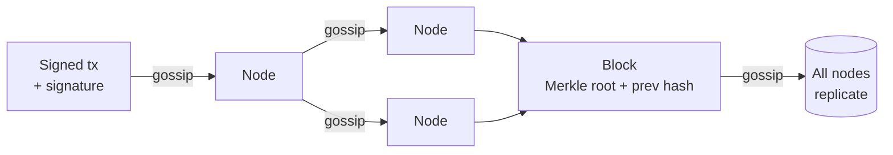

# Lesson 1 — Blockchain fundamentals: the building blocks

**Duration:** ~110 min
**Mode:** theory-forward, no toolchain
**Practice:** a hashing exercise anyone can run in a terminal.

## Objective

Give developers the cryptographic, networking, and consensus foundation *before* Ethereum. By the end they can explain the primitives a blockchain is assembled from — hashes (and the Proof-of-Work mining game they enable), public-key cryptography, digital signatures, what a transaction *is*, Merkle trees, RLP encoding, the P2P protocol, and consensus — and how they combine into an append-only, replicated, tamper-evident log that strangers agree on without a central authority. They also learn the two ways that shared state is actually stored (UTXO vs account model) and why using the network costs gas.

## Learning outcomes

Attendees can:

- Explain what a cryptographic hash guarantees (one-way, avalanche, collision-resistant) and why blocks link via the previous hash.
- Explain how hashing powers the Proof-of-Work mining game: nonce, target, difficulty, and how a winner is verified.
- Describe a public/private key pair and how an address is derived from a public key, with no central registrar.
- Explain how a digital signature authenticates a message and proves integrity without revealing the private key.
- Define a transaction as an atomic, signature-authorised, state-changing event, and contrast it with a database transaction.
- Describe a Merkle tree and why a Merkle proof lets a light client verify membership with `log(n)` hashes.
- Explain why structured data must be serialised deterministically before hashing/signing, and what RLP encodes (byte strings and lists).
- Contrast centralised, decentralised, and distributed topologies and explain what the P2P gossip layer does.
- Explain why open networks need consensus, how Sybil resistance ties influence to a scarce resource, and the difference between Proof of Work and Proof of Stake (incl. finality).
- Contrast the UTXO model (Bitcoin, Corda) with the account model (Ethereum) and explain how each stores state.
- Explain why blockspace is scarce, what gas and gas price meter, and how fee markets and front-running arise.

## Concept-before-tool

There is no toolchain in this lesson — it is pure conceptual groundwork. The only hands-on moment is running a hash from the command line, which needs nothing beyond a terminal. Everything here is the *why* that Lesson 2 (Why Ethereum) and Lesson 4 (Foundry) build on.

## Timing

| Time      | Segment | Notes |
| --------- | ------- | ----- |
| 0:00–0:05 | Framing | "A blockchain isn't one invention. It's well-understood pieces combined." Show the definition + question/primitive table. |
| 0:05–0:20 | Hashes + Proof of Work | Fingerprints. Run the avalanche demo live. Link blocks via prev-hash. Then the mining game: nonce, target, difficulty, verification. |
| 0:20–0:30 | Public-key crypto | Key pair intuition (house address vs door key). `secp256k1`. Derive address from public key. No password reset. |
| 0:30–0:39 | Signatures | The sign/verify handshake. Prove-without-revealing. Every tx is a signed message. |
| 0:39–0:46 | Interlude: what is a transaction? | Atomic, authorised, state-changing. Contrast with a single-server DB transaction. A tx is just bytes to the signer. |
| 0:46–0:57 | Merkle trees | The membership problem → the tree → the proof. Emphasise `log(n)` and light clients. |
| 0:57–1:06 | RLP encoding | Why deterministic serialisation matters. Byte strings + lists. The `"cat"` / `["cat","dog"]` example. Where it shows up (tx, headers, trie). |
| 1:06–1:13 | P2P | Centralised vs distributed. Gossip. Merge of storage and communication. |
| 1:13–1:28 | Consensus | Competing blocks → double-spend. Attack example. Sybil resistance. PoW vs PoS (The Merge). Finality & eventual consistency. |
| 1:28–1:42 | UTXO / Account model | How state is stored. UTXO (Bitcoin, Corda, mixers) vs account model (Ethereum). |
| 1:42–1:52 | Transaction fees / gas | Blockspace scarcity. Gas vs gas price. Fee burn, priority fee, front-running. |
| 1:52–1:55 | Recap + take-home | The primitive table; bridge to Ethereum. |

## Talking points

- **Nothing here is new.** Hashes, asymmetric crypto, and P2P all predate blockchain by decades. The novelty is the *combination* plus economic consensus.
- **Tamper-evidence is the throughline.** Hashes make change detectable; block linking, signatures, and Merkle roots all reuse this one property. Say the word "tamper-evident" often.
- **Avalanche demo lands hard.** Actually run `sha256sum` twice with a one-character change. Seeing two totally different digests is more convincing than any slide.
- **Mining is a hashing game.** You can't aim for a specific hash, but you *can* keep trying nonces until the hash falls below a target. That's all Proof of Work is — expensive to produce, instant to verify. The ~2^78 attempts per Bitcoin block is the "work" being proven.
- **No password reset.** Whoever holds the private key *is* the account. This reframes security for people used to "forgot password" flows — it motivates Lesson 2's fresh-wallet insistence and Lesson 7's security focus.
- **Prove without revealing.** A signature authorises without disclosing the secret — this is why a blockchain needs no logins. A valid signature *is* the authorization.
- **A transaction is the unit of change.** Pin down the definition — atomic, authorised, state-changing — before Merkle trees and consensus, because they're all about ordering and agreeing on *transactions*. To the crypto layer a tx is just a byte array; that's the bridge into RLP.
- **Merkle = cheap proofs.** The payoff is `log(n)` instead of `n`. Tie it to a phone verifying a payment without downloading the chain.
- **RLP is the byte layer underneath.** Signatures and hashes operate on *bytes*, not objects. RLP is how a structured tx/block becomes those bytes, deterministically. Stress: the tx hash on Etherscan is `keccak256(RLP(tx))`. Keep it light — the goal is *why it exists*, not memorising prefix ranges.
- **Points of failure.** Fewer points of failure = harder to censor or switch off. That is the entire motivation for P2P.
- **Consensus is the "eventually agree" part.** Detection (everything before) isn't agreement. Two valid competing blocks fork the chain and revive double-spend; consensus picks one. This is the bridge the whole lesson has been building toward.
- **Sybil resistance is the key insight.** You can't count nodes because identities are free. PoW ties influence to energy, PoS to capital at risk — both make attacking cost more than it's worth. Note The Merge (Sept 2022) moved Ethereum PoW → PoS.
- **UTXO vs account is a mental-model split.** UTXO is bank notes you spend and destroy (Bitcoin, Corda); the account model is a running balance (Ethereum). Use the mixer and Corda-trade diagrams to show UTXO expressiveness, then contrast with Ethereum's balance table + allowance table. Attendees will *live* in the account model.
- **Gas prices a scarce resource.** Blockspace is capped so regular machines can keep up; a capped resource gets auctioned. Separate the two knobs: gas (how much computation) and gas price (what you pay per unit). The burned base fee throttles congestion; the priority fee bribes the validator — which is exactly what enables front-running.

## Diagram (also in slides)

## Hands-on

1. Pick any file (or use `echo "some text"`).
2. Hash it: `sha256sum file` on Linux, or `shasum -a 256 file` on macOS.
3. Change one character and hash again — observe the avalanche effect.
4. Optional: `keccak256` via `cast keccak "hello"` for anyone who already has Foundry (foreshadows Lesson 4).

## Take-home

Hash a file, change one byte, hash again, and confirm the digests share nothing. Then answer: *if a block header commits to a Merkle root, why can't anyone quietly edit an old transaction?* Also go and search for the "zoo" of consensus mechanisms beyond PoW and PoS. Bring the answers to Lesson 2.

## Common pitfalls

- Confusing **encryption** with **signing** — encryption hides content; signing proves origin. Blockchains mostly sign, rarely encrypt.
- Assuming the private key *is* the address — the address is *derived* from the public key, which is derived from the private key.
- Thinking mining *targets* a specific hash — you can't; you brute-force nonces until the hash lands below the target. The puzzle is hard to solve, trivial to check.
- Thinking a Merkle proof needs the whole tree — it needs only the sibling hashes along one path.
- Treating a blockchain transaction like a DB transaction — it updates state replicated across the whole network, not one row on one server.
- Conflating **distributed** and **decentralised** — decentralisation is about control; distribution is about topology. A system can be one without the other.
- Treating RLP as a *type* system — it only encodes byte strings and lists; higher layers assign meaning. Don't rathole on prefix arithmetic.
- Assuming consensus = voting — on an open network, free identities make a node-count majority meaningless (Sybil). Influence must cost a scarce resource.
- Calling Proof of Stake "just voting with tokens" — the slashing penalty (losing your stake) is what makes it costly to attack, mirroring PoW's energy cost.
- Mixing up the **UTXO** and **account** models — in UTXO you consume and recreate outputs (and the fee is the leftover crumb); in the account model you mutate balances and the fee is metered gas.
- Confusing **gas** with **gas price** — gas measures computational effort; gas price is what you pay per unit of that effort.

## Success check

Every attendee can state, in one sentence each, what a hash, a signature, and a Merkle proof give you; why Proof of Work is expensive to produce yet cheap to verify; what makes something a transaction; why a P2P network has no single point of failure; why an open blockchain needs consensus rather than a vote; the difference between the UTXO and account models; and what gas pays for.

## Source material

Adapted and compressed from the team's `full-online-course` section `1-B9basics` (blockchain definitions, public-key cryptosystems, cryptographic hash functions, Merkle trees, distributed consensus, proof of work, distributed vs. decentralised networks). RLP, the Proof-of-Stake / Merge material, the UTXO-vs-account-model comparison, and the gas / transaction-fee material are added to match Ethereum's current design.
