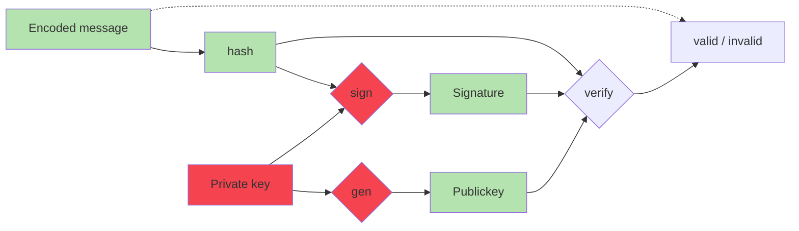

# 2. Public-key cryptography

Identity without a registrar

---

# Asymmetric keys, what you get

Every user holds a **pair** of keys:

<v-clicks depth="2">

- **Public key** — share as needed.
  - ≈ 📍 Your house address.
- **Private key** — keep close to your chest. 
  - ≈ 🗝️ Your key to the house's front door.
- Easy: $Derive(PriKey) \rightarrow PubKey$, a.k.a. _key derivation_.
- "Impossible": $PubKey \cancel{\rightarrow} PriKey$.

</v-clicks>

<!--
- Asymmetric because there is an information asymmetry.
- [click] It is your address people can send to.
- [click] A malicious person can still try to get in.
- [click] It allows you to prove you are you, that you agreed to this or that.
- [click] A malicious person can impersonate you.
- [click]
- [click] Think hash.
-->

---

# Elliptic curves, the ELI 15 maths

$x^3$ & primes & $mod$ & $\oplus$

<v-clicks depth="2">

- A **one-way** math problem: elliptic curves. Concepts:
  - Prime $p$ with the $\equiv x \pmod{p}$ natural numbers: $\mathbb{Z}_p = \{0, 1, \ldots p-1\}$
     Refresher: $p \equiv p-1 + 1 \equiv 0 \pmod{p}$
  - Points on $y^2 \equiv x^3 + a \times x + b \pmod p$. [Curve examples](https://curves.xargs.org/#adding-points-on-a-curve)
  - Scalar addition $\oplus$: draw line → intersection → negate $y$.
    
     🤯: $(G_1 \oplus G_2) \oplus G_3 = G_1 \oplus (G_2 \oplus G_3) = G_2 \oplus (G_1 \oplus G_3)$.
    
  - Scalar multiplication $\otimes$: scalar addition many times. Trap door (see ECDLP).
    
     i.e. $d \times G_1 = G_1 \oplus G_1 \oplus \ldots$: scalar addition $d$ times. 🥲
     🤯: $d_a \otimes (d_b \otimes G_1) = d_b \otimes (d_a \otimes G_1) = (d_a \times d_b) \otimes G_1$.
    
  - Scalar multiplication is efficient.
    
     Example: $22\,713_{10} = 0101\,1000\,1011\,1001_2 \\
    = 2^{14} + 2^{12} + 2^{11} + 2^7 + 2^5 + 2^4 + 2^3 + 2^0 \\
    = 16\,384 + 4\,096 + 2\,048 + 128 + 32 + 16 + 8 + 1$
     Calculate and save $G_2 = 2 \otimes \mathbf{G_1}$; $G_4 = 2 \otimes G_2 = 4 \otimes G_1$; $\mathbf{G_8} = 2 \otimes G_4 = 8 \otimes G_1$;...
     $\Rightarrow 22\,713 \otimes G = G_{16\,384} \oplus G_{4\,096} \oplus G_{2\,048} \oplus G_{128} \oplus G_{32} \oplus G_{16} \oplus G_8 \oplus G_1$
    
  - $\oplus$ & $\otimes$ also work $\pmod{p}$, but with loops. [Modulo result](https://curves.xargs.org/#elliptic-curves-and-finite-fields).
- A defined curve for cryptography: [Ethereum](https://emn178.github.io/online-tools/ecdsa/key-generator)'s pick: [`secp256k1`](https://std.neuromancer.sk/secg/secp256k1).
  - Pick a large prime $p$.
  
   For `secp256k1`: $2^{256} - 2^{32} - 977$
   `0xfffffffffffffffffffffffffffffffffffffffffffffffffffffffefffffc2f`
  
  - Pick the curve's $G$ base point, the _generator_. Pick well, avoid loops ($d \otimes G \equiv e \otimes G$), i.e. "high $n$".
  
   For `secp256k1`:
   `0xfffffffffffffffffffffffffffffffffffffffffffffffffffffffefffffc2f` ← $p$
   `0xfffffffffffffffffffffffffffffffebaaedce6af48a03bbfd25e8cd0364141` ← $n$ 👍
  
- PriKey generation:
  - A large number $priKey$ in the $\mathbb{Z}_p$ field, with $1 \leq priKey \leq n-1$ for safety. 256 bits.
- PubKey derivation: $pubKey = priKey \otimes G$, a point. 512 bits

</v-clicks>

<!--
- [click] Let's review general attributes of curves
- [click] Large prime for safety.
- Natural numbers, but modulo, funny writing, but we know how to do it.
- Computers are good at it.
- [click] To find a modular square, there are algorithms. cf. Tonelli-Shanks.
- [click] Curve property.
- I use this new symbol to avoid conflating with the regular +
- Point _addition_ is this strange (tangent or line) + intersection + flip operation.
- Addition is apt because it is associative. It follows that we have multiplication.
- [click] I use this new symbol to avoid conflating with the regular x.
- Crypto deals in very large numbers, for safety.
- That's how key exchange takes place: Alice and Bob exchange daG1 and dbG1.
- Question: how to multiply efficiently without adding billions of times?
- ECDLP: Elliptic Curve Discrete Logarithm Problem ensures we cannot reverse.
- [click] Do $2 \times log_{10}(n)$ additions.
- [click] All this work is preserved with modulo p.
- These were generic curves properties.
- At some point we need to pick a curve.
- Move onto one curve for crypto.
- [click] Now let's see how we pick a specific curve and prepare it for crypto.
- When you see a curve with fancy name, that's a selection of values.
- What do we need?
- [click] I take on face value that it is a prime...
- [click] The base point will be scalar multiplied.
- A loop is making it easier to guess d from a d*G.
- $n$ is the space of private keys. Here like 1.
- After having picked a specific curve, we move onto the PriKey generation.
- [click] We pick a large number $d$.
- [click] Not necessarily prime.
- Hence the importance of $n$.
- And of choosing randomly.
- Some attacks happen because of the random picker.
- Imagine if it used only 64 random bits.
- [click] Public key is not reversible.
-->

---

# Two things the key pair lets you do

Thanks for cryptographers

<v-clicks depth="3">

- **Sign** — only you [sign](https://rareskills.io/post/ecdsa-tutorial); anyone verifies. *Authenticity.*
  - $signature = sign_{alice}(priKey_{alice}, message)$
  
   In ECDSA practice $signature = sign_{alice}(priKey_{alice}, hash(message))$
   Where $hash$ bit length = $n$ bit length.
   Where $1 \leq k \leq n-1$ at random & unique & quickly forgotten.
   Alt: $k = hash(priKey_2, hash)$, no duplicate, no double sign.
   Compute $k^{-1}$ such that $k \times k^{-1} \equiv 1 \pmod p$ 🥲.
   And $R = k \otimes G$. Take $r \not\equiv 0$ as $x$ coord of $R$.
   And $s \equiv k^{-1} \times (hash + r \times priKey) \pmod p$, if $s \not\equiv 0$.
   $signature = (r, s)$, i.e. 512 bits.
  
  - $ok = verify_{bob}(pubKey_{alice}, signature, message)$
  
   In ECDSA practice $ok = verify_{bob}(pubKey_{alice}, signature, hash(message))$
   Rewrite: $k \equiv s^{-1} \times hash + s^{-1} \times r \times priKey \pmod p$. → $priKey$ still unknown.
   Trick: $k \otimes G = (s^{-1} \times hash) \otimes G \oplus (s^{-1} \times r \times priKey) \otimes G$
   Rewrite: known? → $R = (s^{-1} \times hash) \otimes G \oplus (s^{-1} \times r) \otimes pubKey$ ← Calculable
   Compare: $ok = (r \overset{?}{\equiv} x(calculated) \pmod p)$.
  
  - Difficulty: $pubKey_{alice}$ for real?
- **Encrypt** — anyone encrypts; only you decrypt. *Confidentiality.*
  - $encrypted = encrypt_{bob}(pubKey_{alice}, message_{bob})$
  
   $\cancel{hash}(message)$
  
  - $message_{bob} = decrypt_{alice}(priKey_{alice}, encrypted)$
  - Difficulty: $pubKey_{alice}$ for real?
- Sign + encrypt is possible.
- Blockchains:
  - Signatures at ≈ 100%. Transactions.
  - On-chain: public & forever. Encrypt? 😰
  - Ethereum: $address = keccak256(pubKey) \land (2^{160} - 1)$ → 20 bottom bytes.

</v-clicks>

<!--
- [click]
- [click] Alternative is to use a second private key to hash with message so that an identical message is always signed with the same $k$.
- for $k^{-1}$: EEA: Extended Euclidean Algorithm - $\mathcal{O}(bitLength^2)$
- We want $r \neq 0$ so that we can use the $priKey$.
- We want $s \neq 0$ so that we can get $s^{-1}$.
- We want to keep secret $k$ otherwise formula gives $priKey$.
- Also to never reuse because can deduce from 2 equations.
- Existing exploits of reduced $k$. See Sony ECDSA.
- [click] With the rewritten piece, we do a scalar multiplication.
- Left: known partly, Right: calculable fully.
- [click] In public key infrastructure, a difficulty is making sure you map correctly public keys to the right party.
- Man in the middle attack.
- [click]
- [click]
- [click]
- [click]
- [click] Messages are authenticated and confidential.
- [click]
- [click] Transactions are signed or not accepted.
- [click] Better not leave encrypted stuff on _forever store_.
- [click] Mitigation of who is behind $pubKey$.
- Bottom 160 bits.
- Address holds balance and more.
-->

---

# Key considerations

<v-clicks depth="2">

- Selected curve: [`secp256k1`](https://emn178.github.io/online-tools/ecdsa/key-generator/).
  - Private key: 1 number: see output type as hex. 32 bytes
  - Public key: 2 numbers. `04` prefix → uncompressed. 65 bytes
  - Public address: last 20 bytes of `keccak256(pubKey)`.
- No central authority hands out addresses.
- Brand-new account offline, free, milliseconds. (cf. [vanity addresses](https://vanity-eth.tk))
  - Sybil attacks on-chain ← free.
  - PriKey attacks ← weak key generators, e.g. not full 256 bits randomness.
- Hold priKey → control the account. No password reset.
  - Flip side: NYKNYC
- HD Wallet (24 words): Example BIP-39 _brain wallet_
  - 2,048 ($2^{11}$) words dictionary. 1 word → 11 bits. So 24 words → 264 bits = 256 _entropy_ + 8 checksum
  - `PBKDF2-HMAC-SHA512(entropy) = Master seed`, 512 bits: 256 master priKey || extraEntropy.
  - Child derivation: with splits per network / child / grand child and more.

</v-clicks>

<!--
- [click] Let's look at examples of private and public keys.
- [click:4] You create your own keys and therefore addresses.
- [click] So you can have fun.
- [click] Cannot believe many different addresses are different people.
- [click] And be careful.
- [click] With power comes responsibility.
- [click] Not your keys, not your coins.
- [click] Hierarchical Deterministic
- [click] _Brain_ wallet
- [click] Master seed to create non-traceable new ones.
-->

---
layout: section
---

# 3. Digital signatures

Prove it was you, without revealing your secret

The high level overview

<!--
Let's relax a bit.
-->

---

# The signature handshake

Alice wants everyone to trust that a message is really from her:

<v-clicks>

- **Hash** the message.
- Sign the hash with the **private** key.
- Send the necessary.
- Anyone verifies the signature with the hash against the **public** key.
- Change one byte of the message and verification fails.

</v-clicks>

<!--
- Encoded is not encrypted.
- [click]
- [click] We've seen the detail.
-->

---

# What a signature guarantees

<v-clicks>

- **Authentication** — it came from the holder of the private key.
- **Integrity** — the message was not altered in transit.
- **Non-repudiation** — the signer cannot later deny signing it.

</v-clicks>
<v-clicks at="4">

And crucially:

</v-clicks>
<v-clicks at="5">

- Verifying the signature **reveals nothing** about the private key.
- You prove you hold the secret priKey without disclosing it.

</v-clicks>
<v-clicks at="7">

This is why a blockchain needs no logins. A valid signature *is* the authorization.

</v-clicks>
<v-clicks at="8" depth="2">

- Typically message is public, like transaction.
- In Ethereum, all transactions are signed. → All transactions have an _origin_ address.
  - No man-in-the-middle attack.
- If message is private & hash is public: prove existence of message before disclosure. Cf. sealed envelopes bid.

</v-clicks>

---
layout: iframe
url: https://wall.sli.do/event/b7eLA1Krr6eXAnirLujFka
---