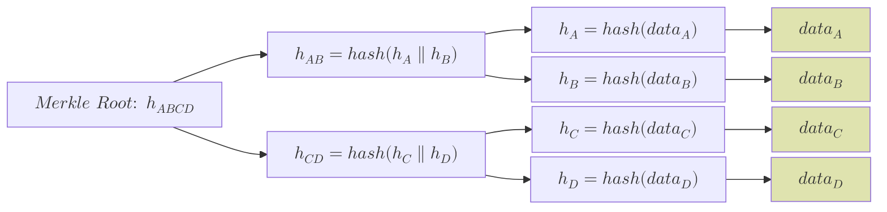
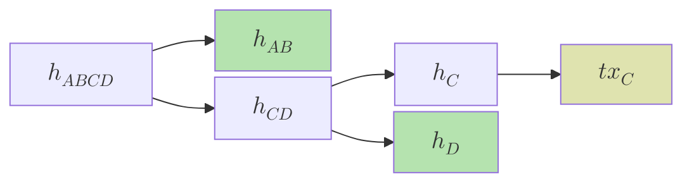
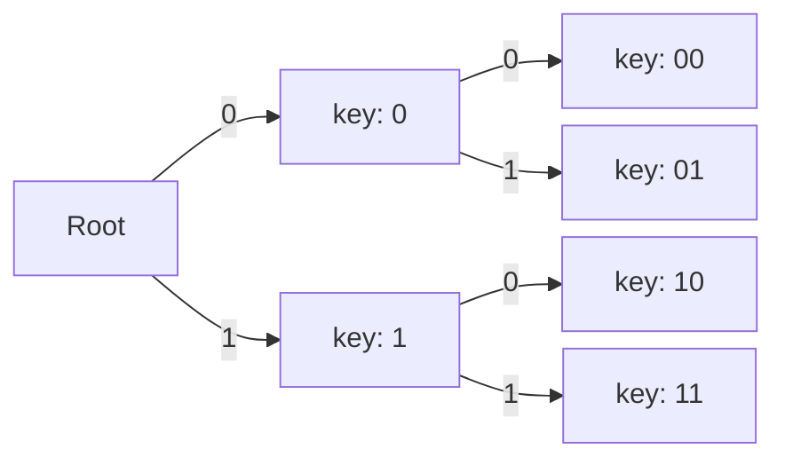
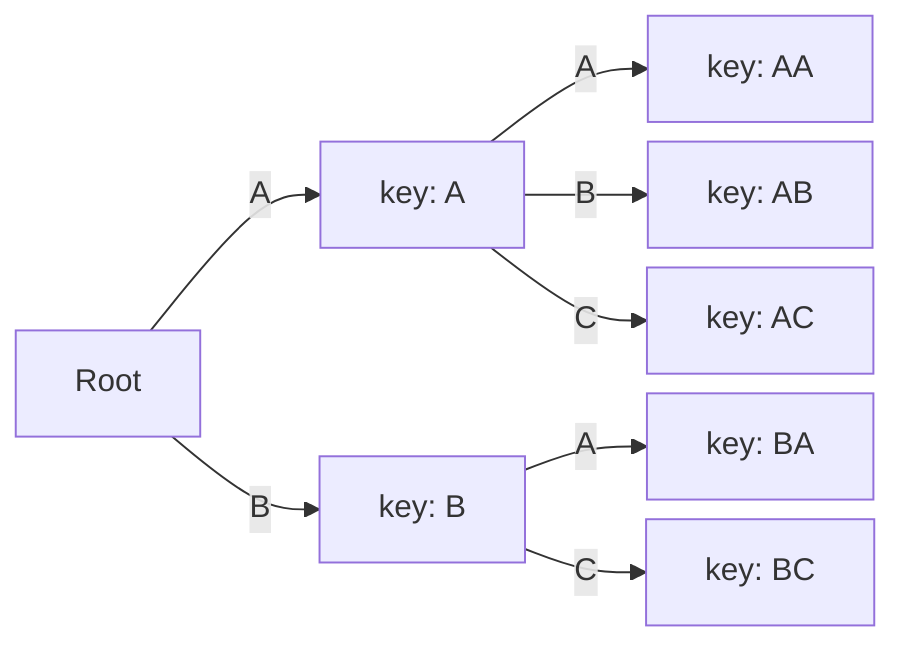
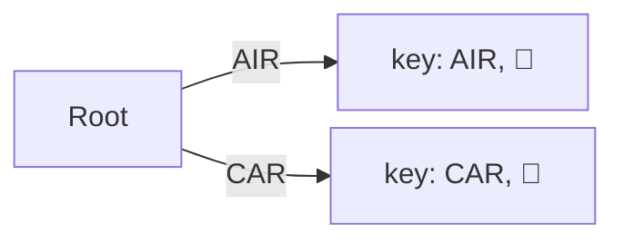
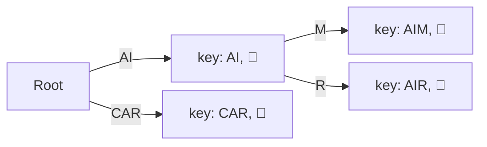
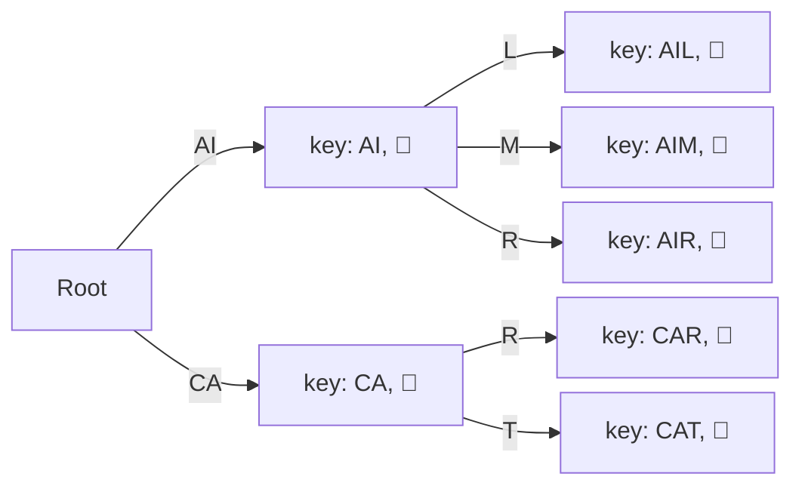

# 4. Merkle trees

Prove membership and precedence without downloading everything

---

# The problem

High-level view

<v-clicks depth="2">

- 1 block contains 0, 1, 10s, 100s, 1,000s of tx.
  - Block header contains 1 hash for all tx.
- Prove **tx1 is in block1**. ~~Download the whole block~~
- Idea 1: disastrous
  - $proof = hash(tx_1 \parallel tx_2 \parallel \ldots \parallel tx_{1\,000})$
  - Verify: order 👍, disclose all 👎, large memory 👎, high compute 👎: $\mathcal{O}(n)$
- Idea 2: naïve
  - $h_1 = hash(tx_1)$, $h_2 = hash(tx_2)$, ... $h_{1\,000} = hash(tx_{1\,000})$
  - $proof = hash(h_1 \parallel h_2 \parallel \ldots \parallel h_{1\,000})$
  - Verify: order 👍, no disclosure 👍, medium memory 🤔, medium compute 🤔: $\mathcal{O}(n)$
- **Merkle trees** solve this:
  - Tree with hashes.
  - Verify: order 👍, no disclosure 👍, low memory 👍, low compute 👍: $\mathcal{O}(log(n))$

</v-clicks>

<!--
- [click:2] Block header contains 1 hash.
- That can be used as proof as we know the properties of hash functions.
- [click] We don't want to download everything.
- [click:2] It's append.
- [click] To verify you need all of it.
- And when you swap 1 tx, you need to recalculate on all.
- [click:7] And when swap 1 tx, also $\mathcal{O}(log(n))$.
-->

---

# Build a Merkle tree

Start from the leaf

<v-clicks depth="2">

- Hash $data$, hash pairs (or other fixed number), upwards.
  - Parallelisable 👍.
- Top hash: **Merkle root** ➤ block header.
- Ethereum _block header_: has multiple Merkle roots. _Block_: has all data.
- If change, hash is different:
  - $h_{ABCD} \neq h_{ACBD} \neq h_{ABCE}$

</v-clicks>

<!--
- The arrow points to the content.
- That's content addressing.
- Works for any content.
- [click:3] Root goes into the block header.
- [click] Block header contains all that is needed to get the block.
- The block contains all there is to know.
- Merkle roots: tx, receipts, state.
- [click:2] Swap or replace, then it's different.
-->

---

# The Merkle proof magic

Prove **$tx_C$** in the tree? Take *sibling* hashes along path to root, $\mathcal{O}(log(n))$:

<v-clicks depth="2">

- Well-known: $root$.
- Proof components: $h_D$ (sibling of $h_C$), $h_{AB}$ (sibling of $h_{CD}$).
- Verifier recomputes: $hash\bigg(h_{AB} \parallel hash\Big(hash(tx_C) \parallel h_D\Big)\bigg) \overset{?}{=} root$. ⚠️ order.
  - Match? → **$tx_C$ included** at right place: verified.
  - 3 hash calculations. (if $1\,000\,000$ txs → ~20 hashes)
  - Never disclosed $tx_A$, $tx_B$, or $tx_D$.

</v-clicks>

<!--
- Now, let's say we care about txs in Ethereum.
- [click] This proof only makes sense if we have a root that we trust.
- [click] Verifier: assembles components.
- What calculation shall we do to verify?
- [click] Order important otherwise hashes change.
-->

---

# Why blockchains care

<v-clicks depth="2">

- **Light clients** — phone verifies payment landed, ~~downloads the whole chain~~:
  - Trusts $root$ only + network sends receipt proof → small compute.
- **Block headers stay tiny** — header stores the Merkle root(s), committing to every tx in the block.
- **Ethereum** uses a Merkle-Patricia trie (sic) for accounts, storage, and receipts — same idea, extended to key-value state.
- **Smart contracts** — compute result with only Merkle proofs of read storage.

</v-clicks>
<v-clicks at="5">

Tamper with any transaction → leaf hash changes → root changes → block header no longer matches. Tamper-evidence again, at scale.

Ethereum mixes Patricia trie with a Merkle tree. See [here](https://ethereum.org/developers/docs/data-structures-and-encoding/patricia-merkle-trie/#state-trie).

A blockchain is a giant graph with everything linked by hash.

</v-clicks>

<!--
- [click:4] A trie is a prefix-tree.
- Patricia: Practical Algorithm to Retrieve Information Coded in Alphanumeric
- Collapse prefixes.
-->

---

# Patricia trie

**Ethereum** uses a Merkle-Patricia trie for accounts, storage, and receipts — same idea, extended to key-value state.

Binary tree

Trie, think dictionary. Can be sparse.

Patricia Trie, think compacted dictionary. Can be sparse. Here 2 words: **AIR** & **CAR**.

Patricia Trie, think compacted dictionary. Can be sparse. We add **AIM**.

Patricia Trie, think compacted dictionary. Can be sparse. We add **AI**.

Patricia Trie, think compacted dictionary. Can be sparse. We add **AIL** & **CAT**.

<v-clicks at="6">

.

</v-clicks>

<!--
- [click:4] We add a new word, we split, with longest prefix.
- Notice that AI node has no definition.
- [click] Notice that AI node now has a definition.
- [click] Notice that CA node has no definition.
- Merkle-Patricia is a Patricia trie with hashes as keys.
-->