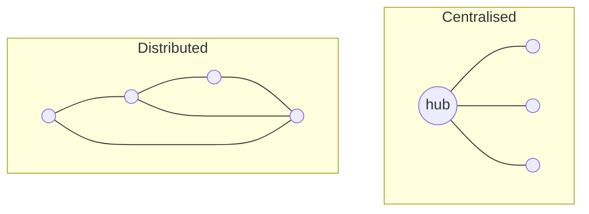

# 6. The P2P protocol

No server, no single point of failure

---

# Centralised vs decentralised vs distributed

Classic diagram

<v-clicks>

- **Centralised** — one hub. Kill it → the network dies. 1 point of failure.
- **Distributed / P2P** — every node connects to peers. No hub to attack, censor, or switch off.
- Fewer points of failure = harder to stop. That is the whole point.

</v-clicks>

---

# What the P2P layer actually does

<v-clicks depth="3">

- **Gossip** — a node tells its peers about new txs and blocks; they tell *their* peers.
  - Data floods the network in seconds.
  - TCP/IP - RLPx - [eth/75](https://github.com/ethereum/devp2p/blob/master/caps/eth.md) Wire protocol
- **Peer discovery** — nodes find each other without a central directory.
  - Some well-known bootnodes to facilitate initial discovery.
- **Node id** ensures that a node does *not*:
  - Talk to itself (≠ IP, same nodeId 🙅‍♂️)
  - Send the same things to the same other nodes. Bloom filters.
- **No trust in any single peer** — verify everything you receive (signatures, hashes, Merkle proofs).
  - ~~Trusting the sender~~.
  - Reject poorly-behaving peers.
  - Encrypt between peers.
- The network merges **storage and communication**: the data lives wherever there is connectivity, not on one server you connect *to*.

</v-clicks>

<!--
- I am not an expert on this.
-->

---

# Putting it together

Reviewing what was learned.

<v-clicks>

- **RLP** encodes all data.
- **Signatures** authorise each transaction.
- **Hashes** link blocks and make tampering evident.
- **Merkle roots** commit to every transaction compactly.
- **P2P** spreads it all with no central server.
- That combination *is* a blockchain.
- Oops. Consensus?

</v-clicks>

<!--

-->