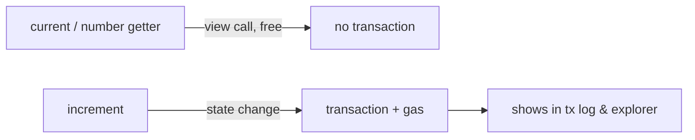
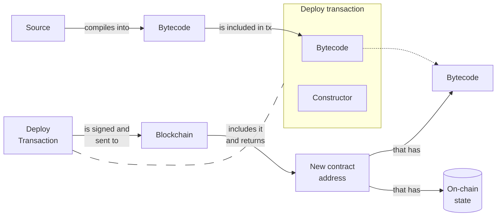
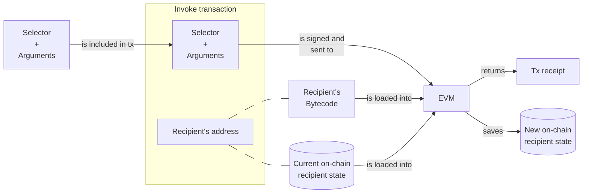
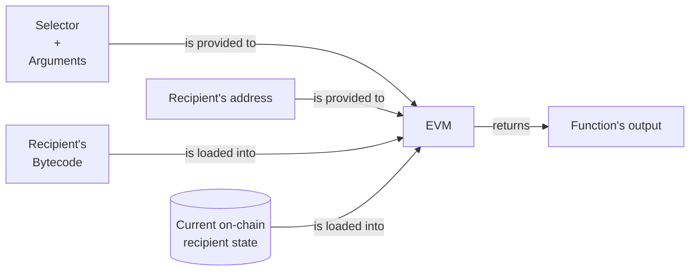

# Your first smart contract

### In the browser, with Remix

Lesson 3 · Ethereum & Solidity for developers

---

## Recap: what did you pay for?

Sending ETH changed balances, i.e. shared state → that's a **transaction** → it costs **gas**.

Today: we write the code that *defines* those state changes.

<!--
- We may have skipped Metamask & sending ETH.
-->

---

# Remix: three tools in one tab

<v-clicks>

The loop we'll repeat all course: **compile → deploy → interact** 🔁.

Note that deploy is only once.

No update possible.

</v-clicks>

<!--
- We'll repeat in browser.
- We'll repeat in Foundry.
-->

---

# Open Remix

<v-clicks depth="2">

1. Go to **[app.remix.live](https://app.remix.live)**.
2. In the **Files explorer** (left icon):
    - Open `contracts/`
    - Create empty `Counter.sol`.
3. Paste the starter code (other slide) into `Counter.sol`.

</v-clicks>
<v-clicks at="6" depth="2">

- Everything runs in browser:
    - Files live in the browser's local storage.
    - No Ethereum account needed. 😅
- Blockchain emulator runs in memory.
    - No faucet required. 😅

</v-clicks>

<!--
- [click] Nothing to install
- [click:5] Remix is good to learn about language only.
- To make your project, it becomes annoying.
- [click:4] You notice at the bottom left: Learn. you can do it yourself.
-->

---

# The beginner contract

In `Counter.sol`.

```solidity
// SPDX-License-Identifier: MIT
pragma solidity ^0.8.24;

contract Counter {
    uint256 public number;          // state, lives on-chain

    function increment() external { // write → transaction → gas
        number += 1;
    }

    function current() external view returns (uint256) {
        return number;              // read → free
    }
}
```

<v-clicks>

Perhaps it's good to copy this once, to get a feel.

Otherwise: https://pastebin.com/QHhBR39t. 

<div class="text-3xl">
QHhBR39t
</div>

</v-clicks>

---

# Four things to notice

<v-clicks depth="2">

- `pragma` is for version:
    - language compatibility.
    - version of compiler.
    - ~~EVM target version~~.
- `public` on `number` **auto-generates a getter**. No boilerplate.
- `view` promises **no state change** → callable for free.
- Changing `public number` costs gas because storage is **replicated across the network**.

</v-clicks>

---

# Read vs write



<v-clicks>

- Blue buttons in Remix = read.
- Orange = write.
- If local node, call remains private.
- If 3rd-party node, they see your calls.

</v-clicks>

---

# Deploy = a transaction carrying bytecode



<v-clicks>

- Tx without a recipient → deployment.
- The returned **address** is where your contract now _lives_. It is deterministic.

</v-clicks>

<!--
- Deploy environment:
  - JSON-RPC.
  - Does it run external before, or use existing?
-->

---
layout: center
---

# Hands-on

Same workflow, throwaway VM or real testnet.

<v-clicks>

1. Complete the starter `Counter.sol`
2. Compile → deploy to the **Remix VM**
3. `increment()`, then read `number`
4. Switch to **Injected Provider — MetaMask** (Sepolia)
5. Deploy for real, find the tx on Etherscan

</v-clicks>

<!--
- Ask if want to do the previous Metamask task, or continue on code only.
- Insist on difference between networks and how airtight.
- Ask if made private, number would be accessible or not.
  - It's replicated on all computers.
  - Validators need its value to compute tx.
- Can you access your neighbour's network?
-->

---

# Hands-on: Constructor

<v-clicks>

1. Add a constructor that sets the initial `number` value.
2. Deploy again.
3. Observe how this is another smart contract.

</v-clicks>
<v-clicks at="4">

Understand:

</v-clicks>
<v-clicks at="5" depth="2">

- Constructor code is:
  - Executed immediately in deploy transaction, then discarded.
  - Has access to eventual smart contract's storage.
- Rest of code is extracted and then stored.
  - Not executed.
- You can have 2 different deployed instances with an identical bytecode.
  - Is it identical here now?

</v-clicks>

---

# Hands-on: What is _invoking a function_?

<v-clicks depth="2">

1. Find your `increment` transaction.
2. Decompile it.
3. Find the selector.
    - How to [create](https://toolio.run/tool/function-selector) selector.
    - [Reverse](https://www.4byte.directory) look-up.
4. Find the packed arguments. Later: ABI
5. Look at the debugger. Replay, rewind.

</v-clicks>
<v-clicks at="8">

Understand:

</v-clicks>
<v-clicks at="9" depth="2">

- The selector, and the observed packing of arguments is a **standard**.
  - Adopted by Solidity, Vyper, Yul, LLL and others for compatibility.
- It is **not** an EVM requirement.
- A read call does that packing too.
- It is possible to simulate a write call as a read: `eth_call`.
  - Including with a state override. (advanced)

</v-clicks>

---

# Invoke, by a **transaction** carrying byte data

And with the smart contract as recipient.



<v-clicks>

- The receipt and new on-chain state are deterministic.
- Sender is who signed the tx. `tx.origin`
- There are ways to do a pretend transaction on a live fork.

</v-clicks>

<!--
- [click:2] Touch on risks of `tx.origin`.
-->

---

# Invoke, by a **read call** carrying byte data

And with the smart contract as recipient.



---

# Hands-on: What is _sending eth to the smart contract_?

<v-clicks>

1. Try to attach eth to your transaction.
2. Add `payable`; retry.
3. Try to get back the eth sent.

</v-clicks>
<v-clicks at="4">

Understand:

</v-clicks>
<v-clicks at="5" depth="2">

- The instance has now its own balance. It is not yours.
- Moreover, it's lost forever (*).
- That you deployed the instance does not give you any right.
    - Unless you coded it in.
- That would be true of other tokens, with a different mechanism.

</v-clicks>

<!--
- [click:6] Forever until:
  - There is a fork for that
  - Or inactive contracts are culled.
  - Or a private key quantum hack.
-->

---

# Exercise: `decrement`

Yes, `-= 1`

<v-clicks depth="2">

- Go to zero: What happened?
    - Try `unchecked { }`.
    - What happens?
- Anyone can call functions.
    - Satisfied?
    - Solutions?

</v-clicks>

---
layout: center
hide: true
---

# Take-home

Add `decrement()` that **reverts if `number` is 0**.

```solidity
require(0 < number, "Counter: already zero");
```

Redeploy to Sepolia, share your address. We'll see `require` next lesson.

---

# Understanding versions

"Ethereum" isn't one fixed thing. A few pieces move **independently**:

<v-clicks>

- **The EVM** — the engine that runs your code. It gets **upgraded** over time (hard forks), and different chains can sit at different versions. `Prague`, `Paris`
- **Solidity** — the language, versioned on its own (that `pragma` line). Newer compilers change syntax and defaults. You compile with a target EVM version. Sometimes new versions drop support to old EVMs.
- **Networks** — mainnet, Sepolia, and many more. Same tools, but **different state, rules, and money**. At different EVM versions, different consensus types and parameters.
- **Transaction types** — not every tx is the same shape; there are **several types** with different fields and behavior. Not all signatures are of the same versions.
- **Networking protocols** — nodes find and talk to each other over their own versioned wire protocols (e.g. `devp2p`, `eth/68`). Client software (Geth, Nethermind, …) upgrades these independently too.
- You don't need the details today. Just hold **the map**: when something behaves differently than expected, it's usually one of these axes that moved.

</v-clicks>

---
layout: iframe
url: https://wall.sli.do/event/myrV9QeAwXsGtpcTMjF3Ek
---