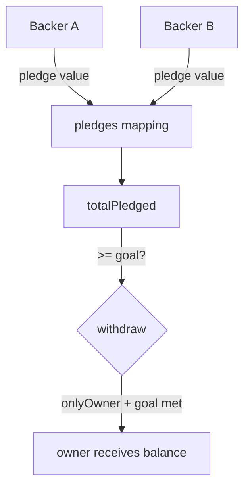

# Lesson 5 — Solidity deep dive

**Duration:** ~60 min · **Mode:** live-along, local Foundry
**Practice:** build the running example — a crowdfunding `Escrow`.

## Objective

Move beyond toy contracts. Introduce the Solidity you actually need — mappings,
structs, events, modifiers, custom errors, visibility, and the ether-handling
model (`payable`, `msg.sender`, `msg.value`) — each as the solution to a
concrete problem. Start the **running example** that threads through the rest of
the course.

## Learning outcomes

Attendees can:

- Use mappings and (briefly) structs to model per-address state.
- Emit events and explain why `indexed` matters for apps.
- Guard functions with modifiers and revert with custom errors.
- Receive and send ETH (`payable`, `msg.value`, `call`), and reason about
  `msg.sender`.

## Concept-before-tool

No new tool today — the "tool" is the Solidity language itself. Introduce each
construct by the problem it solves rather than by syntax:

- *"How do I track a balance per user?"* → **mapping**
- *"How does my app know something happened?"* → **event**
- *"How do I restrict who can call this?"* → **modifier**
- *"How do I reject bad input cheaply?"* → **custom error**

## Timing

| Time    | Segment | Notes |
| ------- | ------- | ----- |
| 0:00–0:05 | Recap take-home | `require`/reverts from the `decrement` exercise. |
| 0:05–0:12 | The problem | "Build crowdfunding escrow: backers pledge, owner withdraws at goal." |
| 0:12–0:22 | Mappings & state | `pledges` mapping, `totalPledged`, `immutable` owner/goal. |
| 0:22–0:32 | `payable` & ether | `pledge()` receives `msg.value`; `msg.sender` is the backer. |
| 0:32–0:42 | Events | `Pledged`, `indexed`, why apps read logs not storage. |
| 0:42–0:52 | Modifiers & errors | `onlyOwner`, custom errors vs require-strings. |
| 0:52–0:58 | `withdraw()` | Send ETH with `call`; note "we'll harden this in Lesson 7." |
| 0:58–1:00 | Recap + take-home | |

## Talking points

- **Mappings are the workhorse.** `mapping(address => uint256)` is a per-key
  slot; there is no length, no iteration. Model accordingly.
- **`immutable` vs `constant`.** `immutable` is set once in the constructor and
  then fixed (and cheap to read). Good for `owner` and `goal`.
- **`payable` is opt-in.** A function can only receive ETH if marked `payable`.
  `msg.value` is the wei sent; `msg.sender` is who called.
- **Events are the app seam.** Contracts can't push to a UI; apps read **logs**.
  `indexed` parameters become filterable topics. This is the hook for Lesson 10.
- **Custom errors** (`revert ZeroPledge()`) are cheaper than long require
  strings and document failure modes. Introduced in 0.8.4+.
- **Sending ETH.** `owner.call{value: amount}("")` returns success as a bool —
  check it. Flag loudly: *this `withdraw` is deliberately naive; Lesson 7 shows
  why and fixes it.*

## The contract

See [`code/starter/Escrow.sol`](./code/starter/Escrow.sol) (fill-in) and
[`code/solution/Escrow.sol`](./code/solution/Escrow.sol). Drop it into the
`src/` of the Foundry project from Lesson 4.

## State model (also in slides)

## Hands-on

Complete the starter's TODOs, `forge build`, deploy to `anvil`, then `pledge`
from two different anvil accounts and watch `totalPledged` and the `Pledged`
events.

## Take-home

Add an admin-only `setGoalReachedMessage(string)` guarded by the `onlyOwner`
modifier, plus a public string it sets. Small, but it drills modifiers and
storage. Keep it in your project — we test it next lesson.

## Common pitfalls

- Forgetting `payable`, so `pledge()` can't receive ETH.
- Reading a `view`-free getter and expecting a transaction.
- Ignoring the bool returned by `call` (silent failed transfers).

## Success check

A richer `Escrow` on anvil that tracks per-address pledges and emits events on
every pledge.
