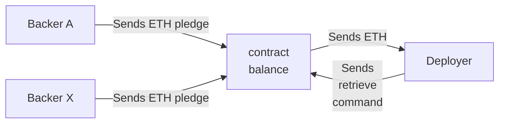
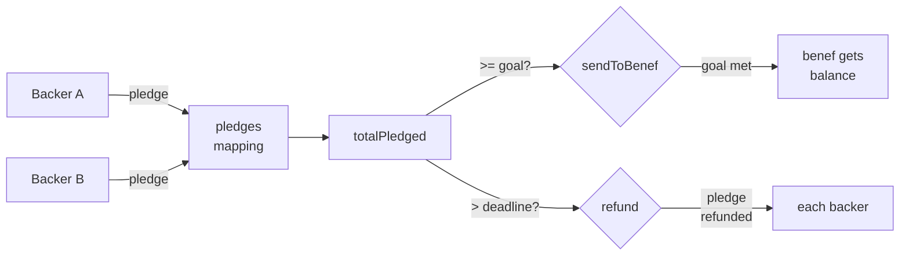

# Solidity deep dive

### Building the running example: a crowdfunding Escrow

Lesson 5 · Ethereum & Solidity for developers

---

# Today's problem

As a project:

<v-clicks>

- Someone, the owner, creates a crowdfunding goal for their benefit.
- Backers pledge ETH toward a goal.
- The owner can withdraw **only** once the goal is reached.
- More constraints?

</v-clicks>
<v-clicks>

🪜 We'll meet each Solidity feature as the answer to a question the project raises.

🤔 Start now to think about which extra constraints are necessary.

</v-clicks>

<!--
- I want to present how to do things.
- Not so much list types and other things that can be referenced back in docs.
- [click:2] Future feature: any token.
- [click] Why not before?
- [click:3] What goes into the smart contract.
- What goes off-chain, with what link perhaps? A hash?
-->

---

# New empty project

Scaffolding first

Forge → empty project:

````md magic-move
```bash
forge init escrow --empty

Initializing...
...
    Initialized forge project

```
```bash
forge init escrow --empty
touch escrow/src/Escrow.sol
```
````

<v-clicks>

We start work in `escrow/src/Escrow.sol`.

</v-clicks>

---

# Basic elements of contract

Think back to `Counter.sol`

````md magic-move [Escrow.sol]
```solidity
// SPDX-License-Identifier: MIT
pragma solidity ^0.8.34;
```
```solidity
pragma solidity ^0.8.34;

contract Escrow {
}
```
```solidity
contract Escrow {
    constructor() {
    }
}
```
```solidity
contract Escrow {
    goal;

    constructor() {
    }
}
```
```solidity
contract Escrow {
    uint256 goal;

    constructor() {
    }
}
```
```solidity
contract Escrow {
    uint256 public goal;

    constructor() {
    }
}
```
```solidity
contract Escrow {
    uint256 public goal;

    constructor(uint256 _goal) {
        goal = _goal;
    }
}
```
````

<v-clicks depth="2" at="1">

- Start with `contract`, i.e. *class* type. Remix for quick syntax help.
- There is a funding goal, a number. Where does it go?
  - Goes into the smart contract state. What type?
  - A number `> 0` && no constraint → `uint256`. `private` / `public`?
  - `public`: anyone can ~~modify~~ **read** it. How / where do we set it?
- Deployer sets goal at construction.
- Any comment about this goal and its lifecycle? Pros / cons? Trade-offs?
- What if `goal == 0`?

</v-clicks>

<!--
- `pragma ^` is ok when starting a project.
- When getting closer to auditing, should fix version.
- [click] Which first function to add? `constructor`
- [click] Like `number` in `Counter`.
- Do we need to keep it across tx invocations?
- [click] Does not compile.
- Needs type.
- [click] What does a hover tell you about visibility of field?
- [click] It is a well-known info.
- And cannot hide it from backers anyway.
- At what point do we set the goal?
- [click] Conventional way to use `_` for potentially confusing variables.
- [click] Will the goal change?
- [click] Could be meaningful to add error in constructor.
- -> no deployed code.
-->

---

# Design choice: goal does not change

How to express that? Choices:

| Feature | read/write | `constant` | `immutable` |
| --- | --- | --- | --- |
| Value assignment | assigned at deployment-time | hardcoded at compile-time | dynamically assigned at deployment-time |
| How EVM stores it | in storage | in bytecode | in bytecode |
| Gas efficiency | expensive | cheap | cheap |
| Use cases | modifiable | fixed math values | values unique to instance |

Our pick:

````md magic-move [goal field lifecycle]
```solidity
    uint256 public ???? goal;
```
```solidity
    uint256 public immutable goal;
```
````

---

# `Escrow` instance account and balance

Who controls what.

<v-clicks depth="2">

- Smart contract instance has 1 address & 1 ETH balance.
- ETH sent to this address → gets credited to it.
- Code is only arbiter of what happens to this balance.
  - Just as it is for *standard* storage.
- Deployer (owner?) of the instance → controls the code ~~the ETH balance~~.
- Deployed code is immutable → think now.

</v-clicks>
<v-clicks>



</v-clicks>

---

# Retrieving the ETH pledged

Warning: we are moving ETH, this is where we need to be careful and think adversarially.

````md magic-move
```solidity
contract Escrow {
    uint256 public immutable goal;

    constructor(...) {... }
}
```
```solidity
contract Escrow {
    uint256 public immutable goal;

    constructor(...) {... }

    function withdraw() public {
    }
}
```
```solidity
function withdraw() public {
    address(this).balance;
}
```
```solidity
function withdraw() public {
    uint256 amount = address(this).balance;
}
```
```solidity
function withdraw() public {
    uint256 amount = address(this).balance;
    msg.sender;
}
```
```solidity
function withdraw() public {
    uint256 amount = address(this).balance;
    msg.sender.call("");
}
```
```solidity
function withdraw() public {
    uint256 amount = address(this).balance;
    msg.sender.call{value: amount}("");
}
```
```solidity
function withdraw() public {
    uint256 amount = address(this).balance;
    (bool ok, ) = msg.sender.call{value: amount}("");
}
```
```solidity
function withdraw() public {
    uint256 amount = address(this).balance;
    (bool ok, ) = msg.sender.call{value: amount}("");
    require(ok, "Escrow: withdraw failed");
}
```
````

<div v-if="$clicks <= 0">

- Yes, yes, we have not thought about sending ETH to the escrow yet.
- What shape of a withdraw?

</div>
<v-clicks at="1">

- A `function`. What and how much to withdraw?
- Because it collected ETH → balance. `address(this)` is a cast to `address` type.
- A variable for readability. To whom to send it?
- To the function caller, right? After all, only the sender will call this function, right?? 😈
- `.call` sends data bytes to address, here `""`: no data.
- With optional params like `value`, i.e. ETH from balance. Is atomicity respected?
-  Is atomicity respected now?
- `require` reverts the transaction (or outer call) when not satisfied.
- `withdraw` complete?

</v-clicks>

<!--
- We think about getting ETH out.
- It's a choice. Could think of pledging first.
- For the course: it's easier.
- For defensive coding: we prepare clean-up first.
- [click] When owner withdraws, owner will send a transaction that will invoke code to send the balance.
- [click] ETH is the base token.
- [click] For now we do not optimise prematurely.
- [click] Note how Remix compiler does not flag a floating value, not used, not returned.
- It's because it puts it on the stack, and could be used by an `assembly` block.
- How can we control it's the right caller?
- Adversarially: anyone can call this function.
- We come back to this problem.
- How to send something to an address?
- [click] `.call` sends all remaining gas minus the necessary for returning the function.
- Compiler decides.
- It's a fairly low-level call.
- How to send ETH?
- [click] Call returns values, so can fail silently.
- [click] We do not care what data the function call returned.
- [click] Can put message or error code. Clients can read it.
- [click] Potential problems:
- Not owner calling.
- Backers believing goal not reached -> backing more than intended.
-->

---

# Define an idiomatic error

Strings carry little info. Pass structured data in errors.

````md magic-move
```solidity
contract Escrow {
    ...
    function withdraw() public {
        uint256 amount = address(this).balance;
        (bool ok, ) = msg.sender.call{value: amount}("");
        require(ok, "Escrow: withdraw failed");
    }
}
```
```solidity
error SendFailed(address recipient);

contract Escrow {
    ...
    function withdraw() public {
        uint256 amount = address(this).balance;
        (bool ok, ) = msg.sender.call{value: amount}("");
        require(ok, "Escrow: withdraw failed");
    }
}
```
```solidity
error SendFailed(address recipient);

contract Escrow {
    ...
    function withdraw() public {
        uint256 amount = address(this).balance;
        (bool ok, ) = msg.sender.call{value: amount}("");
        require(ok, SendFailed(msg.sender));
    }
}
```
````

<v-clicks at="1">

- Define a custom error. Byte result is same as a function.
  - Nested in the contract or not.
- Use the custom error.
- ABI-encoded.
  - Ether.js will decode.

</v-clicks>

<!--
- [click] `SendFailed` sounds generic enough -> outside the contract.
-->

---

# Design choice: once the goal is reached

Another requirement

````md magic-move
```solidity
function withdraw() public {
    uint256 amount = address(this).balance;
    (bool ok, ) = msg.sender.call{value: amount}("");
    require(ok, SendFailed(msg.sender));
}
```
```solidity
error GoalNotReached(uint256 amount, uint256 goal);

function withdraw() public {
    uint256 amount = address(this).balance;
    (bool ok, ) = msg.sender.call{value: amount}("");
    require(ok, SendFailed(msg.sender));
}
```
```solidity
error GoalNotReached(uint256 amount, uint256 goal);

function withdraw() public {
    uint256 amount = address(this).balance;
    require(goal <= amount, GoalNotReached(amount, goal));
    (bool ok, ) = msg.sender.call{value: amount}("");
    require(ok, SendFailed(msg.sender));
}
```
```solidity
error GoalNotReached(uint256 amount, uint256 goal);

function withdraw() public {
    uint256 amount = address(this).balance;
    require(goal <= amount, GoalNotReached({ amount: amount, goal: goal}));
    (bool ok, ) = msg.sender.call{value: amount}("");
    require(ok, SendFailed(msg.sender));
}
```
````

<v-clicks at="1">

- Specific error to inform.
- Goal not reached → transaction reverts.
- Can make explicit.
- Do we want to withdraw only `goal`, or `amount`? Pros and cons.
- Premature optimisation: save `goal` into memory. Why?
- What important restriction have we forgot?

</v-clicks>

<!--
- What are we going to do?
- [click] This time sounds specific to smart contract -> inside.
- Pros and cons of both values in error.
- Which command will be use?
- [click] `require` is `if not -> revert`.
- [click:2] If withdraw only goal, what happens to remainder? Belongs to whom?
- [click] Can rely on Solidity. And if frequent function used.
- [click] Anyone can withdraw?
- Can continue backing to goal?
-->

---

# Design choice: only beneficiary can withdraw

How to go about it? How to define a beneficiary? Who is it?

````md magic-move
```solidity
...
contract Escrow {
    ...
}
```
```solidity
contract Escrow {
    uint256 public immutable goal;

    constructor(uint256 _goal) {
        goal = _goal;
    }
}
```
```solidity
contract Escrow {
    uint256 public immutable goal;
    address public beneficiary;

    constructor(uint256 _goal) {
        goal = _goal;
    }
}
```
```solidity
contract Escrow {
    uint256 public immutable goal;
    address public beneficiary;

    constructor(uint256 _goal, address _beneficiary) {
        goal = _goal;
        beneficiary = _beneficiary;
    }
}
```
```solidity
contract Escrow {
    uint256 public immutable goal;
    address public beneficiary;

    constructor(uint256 _goal) {
        goal = _goal;
        beneficiary = msg.sender;
    }
}
```
```solidity
contract Escrow {
    uint256 public immutable goal;
    address public beneficiary;

    constructor(uint256 _goal) {
        goal = _goal;
        beneficiary = msg.sender;
    }
}
```
````

<v-clicks at="1">

- Need to know beneficiary when `withdraw`. In the *future*. Deploy tx != withdraw tx.
- How to get beneficiary?
- Any problem with passing the `beneficiary` in the constructor?
- `msg.sender` is more idiomatic, avoids errors. What is `msg`?
  - Who is `msg.sender` in nested transaction? See [`msg` and more](https://docs.soliditylang.org/en/latest/units-and-global-variables.html#block-and-transaction-properties).
- `immutable` or not? Pros and cons?
- This is [owner pattern](https://github.com/OpenZeppelin/openzeppelin-contracts/blob/v5.6.1/contracts/access/Ownable.sol).

</v-clicks>

<!--
- In the contract, or outside the contract?
- [click] It will have to be saved as field.
- [click] 
- [click] Could mistype and find out only at withdraw. Unlike goal.
- [click] This demonstrates that there is something at `msg.sender`.
- Why not `tx.origin`?
- Talk about `msg` and `block`.
- [click] Cannot transfer "ownership", cannot use as collateral.
- [click] This is an owner pattern.
-->

---

# Enforce: beneficiary-only withdrawal

When withdrawing. Ideas?

````md magic-move
```solidity
function withdraw() public {
    uint256 amount = address(this).balance;
    require(goal <= amount, GoalNotReached(amount, goal));
    (bool ok, ) = msg.sender.call{value: amount}("");
    require(ok, SendFailed(msg.sender));
}
```
```solidity
error NotBeneficiary(address beneficiary, address sender);

function withdraw() public {
    uint256 amount = address(this).balance;
    require(goal <= amount, GoalNotReached(amount, goal));
    (bool ok, ) = msg.sender.call{value: amount}("");
    require(ok, SendFailed(msg.sender));
}
```
```solidity
error NotBeneficiary(address beneficiary, address sender);

function withdraw() public {
    if (msg.sender != beneficiary) revert NotBeneficiary(beneficiary, msg.sender);
    uint256 amount = address(this).balance;
    require(goal <= amount, GoalNotReached(amount, goal));
    (bool ok, ) = msg.sender.call{value: amount}("");
    require(ok, SendFailed(msg.sender));
}
```
```solidity
error NotBeneficiary(address beneficiary, address sender);

function withdraw() public {
    require(msg.sender == beneficiary, NotBeneficiary(beneficiary, msg.sender));
    uint256 amount = address(this).balance;
    require(goal <= amount, GoalNotReached(amount, goal));
    (bool ok, ) = msg.sender.call{value: amount}("");
    require(ok, SendFailed(msg.sender));
}
```
```solidity
error NotBeneficiary(address beneficiary, address sender);

modifier onlyBeneficiary() {
    require(msg.sender == beneficiary, NotBeneficiary(beneficiary, msg.sender));
    _; // The rest of the other modifiers and the function call
}

function withdraw() public {
    uint256 amount = address(this).balance;
    require(goal <= amount, GoalNotReached(amount, goal));
    (bool ok, ) = msg.sender.call{value: amount}("");
    require(ok, SendFailed(msg.sender));
}
```
```solidity
error NotBeneficiary(address beneficiary, address sender);

modifier onlyBeneficiary() {
    require(msg.sender == beneficiary, NotBeneficiary(beneficiary, msg.sender));
    _; // The rest of the other modifiers and the function call
}

function withdraw() public onlyBeneficiary {
    uint256 amount = address(this).balance;
    require(goal <= amount, GoalNotReached(amount, goal));
    (bool ok, ) = msg.sender.call{value: amount}("");
    require(ok, SendFailed(msg.sender));
}
```
````

<v-clicks at="1">

- A specific error message.
- At the start, so that it is gated.
- More idiomatic way.
- Such prerequisite is a regular occurrence → `modifier`.
- And use it.

</v-clicks>

<!--
- We have the beneficiary, how do you use it now?
- We are going to reject when not beneficiary.
- [click] Error message can be expressive.
- [click] Regular `revert` does not waste all gas.
- Unlike `assert` that is better used for invariants.
- [click] We saw `require` before. That is the same under the hood.
- [click] Here may not be regular occurrence, `owner` is typical.
- Good to learn anyway.
- [click] Takes place before. Order is respected.
-->

---

# Paradigm change: good samaritan

Smart contract has all info, needs impulse.

````md magic-move
```solidity
error NotBeneficiary(address beneficiary, address sender);

modifier onlyBeneficiary() {
    require(msg.sender == beneficiary, NotBeneficiary(beneficiary, msg.sender));
    _; // The rest of the other modifiers and the function call
}

function withdraw() public onlyBeneficiary {
    uint256 amount = address(this).balance;
    require(goal <= amount, GoalNotReached(amount, goal));
    (bool ok, ) = msg.sender.call{value: amount}("");
    require(ok, SendFailed(msg.sender));
}
```
```solidity
error NotBeneficiary(address beneficiary, address sender);

modifier onlyBeneficiary() {
    require(msg.sender == beneficiary, NotBeneficiary(beneficiary, msg.sender));
    _; // The rest of the other modifiers and the function call
}

function withdraw() public onlyBeneficiary {
    uint256 amount = address(this).balance;
    require(goal <= amount, GoalNotReached(amount, goal));
    (bool ok, ) = beneficiary.call{value: amount}("");
    require(ok, SendFailed(beneficiary));
}
```
```solidity
function withdraw() public {
    uint256 amount = address(this).balance;
    require(goal <= amount, GoalNotReached(amount, goal));
    (bool ok, ) = beneficiary.call{value: amount}("");
    require(ok, SendFailed(beneficiary));
}
```
```solidity
function sendToBeneficiary() public {
    uint256 amount = address(this).balance;
    require(goal <= amount, GoalNotReached(amount, goal));
    (bool ok, ) = beneficiary.call{value: amount}("");
    require(ok, SendFailed(beneficiary));
}
```
````

- Why check sender is beneficiary? Any change idea?

<v-clicks at="1" depth="2">

- Use value instead of checking appropriateness.
- Less code.
- Fix name match action.
- Design pattern: good samaritan / alarm clock.
- Sometimes valid.
  - Balance with effects of beneficiary reverting tx.
  - Risk: hijack other's tx to use other people's gas.

</v-clicks>

<!--
- Note how compare `msg.sender` and `beneficiary` then use `msg.sender`.
- Let's do idiomatic.
- [click] 
- [click] Sorry we did all this. It was good learning.
-->

---

# Feature: possible to deposit funds

Multiple deposits, first idea.

````md magic-move
```solidity
contract Escrow {
}
```
```solidity
contract Escrow {
    receive() external payable {
    }
}
```
```solidity
contract Escrow {
    receive() external payable {
    }
    fallback() external {
    }
}
```
```solidity
contract Escrow {
    receive() external payable {
    }
}
```
````

<v-clicks at="1">

- Backer sends ETH directly to the smart contract address. Use default function.
- Remember function selector? No, or unknown, selector → `fallback` or `receive`.
- Pros and cons?
- What are failure modes of contract?
- How to mitigate?

</v-clicks>

<!--
- [click] `payable` to receive ETH.
- History why `payable` exists.
- [click] Other default function.
- [click:2] Failure: Goal not reached.
- Failure: nobody withdraws after goal reached.
- Failure: backer deposits after withdrawal.
- [click] Contract state as in state machine. receiving -> reached / failed -> withdrawn / wind-down.
-->

---

# Genius idea, or bad idea?

Last donor past the goal, executes the send:

````md magic-move
```solidity
contract Escrow {
    receive() external payable {
    }
}
```
```solidity
contract Escrow {
    receive() external payable {
        uint256 amount = address(this).balance;
        if (goal <= amount) {
            (bool ok, ) = msg.sender.call{value: goal}("");
            require(ok, SendFailed(msg.sender));
        }
    }
}
```
```solidity
contract Escrow {
    receive() external payable {
        uint256 amount = address(this).balance;
        if (goal <= amount) {
            (bool ok, ) = beneficiary.call{value: goal}("");
            require(ok, SendFailed(beneficiary));
        }
    }
}
```
```solidity
contract Escrow {
    receive() external payable {
        uint256 amount = address(this).balance;
        if (goal <= amount) {
            (bool ok, ) = beneficiary.call{value: amount}("");
            require(ok, SendFailed(beneficiary));
        }
    }
}
```
```solidity
contract Escrow {
    receive() external payable {
        if (goal <= address(this).balance) sendToBeneficiary();
    }
}
```
```solidity
contract Escrow {
//    receive() external payable {
//    }
}
```
````

<v-clicks at="1">

- Balance updated before invoking `receive`, good.
  - Any problem with this code?
- `beneficiary`, not `msg.sender` obviously.
  - In this invocation, `msg.sender` is the donor, not the beneficiary.
  - What else?
- Send `amount` of course.
- Shorten it. Pros and cons?
- Let's do it right.

</v-clicks>

<!--
- [click:3] Looks like `sendToBeneficiary` now.
- [click] Classic case of mixing roles. 
- When in doubt, avoid doing too much.
- [click] Just not have this function that can make it difficult.
- Possible to send by `selfdestruct`.
-->

---

# Track balance per user → mapping

Failure mode: goal not reached, or withdraw not executed.

````md magic-move
```solidity
contract Escrow {
    uint256 public immutable goal;
    address public beneficiary;
    // Map each donor to their pledge
}
```
```solidity
contract Escrow {
    uint256 public immutable goal;
    address public beneficiary;
    mapping(XX => YY) pledges;
}
```
```solidity
contract Escrow {
    uint256 public immutable goal;
    address public beneficiary;
    mapping(address => uint256) pledges;
}
```
```solidity
contract Escrow {
    uint256 public immutable goal;
    address public beneficiary;
    mapping(address => uint256) public pledges;
}
```
````

- Mapping: a per-key storage slot. No initialisation.

<v-clicks at="1" depth="2">

- What types?
- Each backer keeps a balance.
- `public` → free getter:
  - `function pledges(donorAddress) public returns(uint256)`.
- [Storage location](https://docs.soliditylang.org/en/latest/internals/layout_in_storage.html#mappings-and-dynamic-arrays): deterministic, with hash.
  - Individual storage slot size: 256 bits.
  - Individual storage slot identifier: 256 bits too.
  - $2^{256}$ storage slots available. Collision unlikely.

</v-clicks>

<!--
- Any idea of the format?
-->

---

# Receive ETH → payable

We receive and keep track.

````md magic-move
```solidity
contract Escrow {
    mapping(address => uint256) public pledges;
}
```
```solidity
contract Escrow {
    mapping(address => uint256) public pledges;

    function pledge() external payable {
        // TODO
    }
}
```
```solidity
contract Escrow {
    mapping(address => uint256) public pledges;
 
    function pledge() external payable {
        pledges[msg.sender] = msg.value;
    }
}
```
```solidity
contract Escrow {
    mapping(address => uint256) public pledges;
 
    function pledge() external payable {
        pledges[msg.sender] = msg.value;
    }
}
```
```solidity
contract Escrow {
    mapping(address => uint256) public pledges;
 
    function pledge() external payable {
        require(pledges[msg.sender] == 0);
        pledges[msg.sender] = msg.value;
    }
}
```
```solidity
contract Escrow {
    mapping(address => uint256) public pledges;

    function pledge() external payable {
        pledges[msg.sender] += msg.value;
    }
}
```
````

<v-clicks at="1" depth="2">

- `payable` → allowed to receive value.
- `msg.value` = wei sent· `msg.sender` = the caller. Any bug?
- No assumption. Expect called multiple times. Options?
  - Gate with a `require`? 🤢
  - Proper: `+=`.
- Also, Solidity checks for `uint` [overflow](https://docs.soliditylang.org/en/latest/080-breaking-changes.html#silent-changes-of-the-semantics).

</v-clicks>

<!--
- [click] Touch on why `payable` was invented.
- [click] A new call overwrites previously stored value.
- Akin to losing other people's money.
- [click:2] Not elegant.
- Legitimate use of calling mutltiple times.
-->

---

# Inform app → event

Backer wants to know: recorded ✅.

````md magic-move
```solidity
contract Escrow {
    mapping(address => uint256) public pledges;

    function pledge() external payable {
        pledges[msg.sender] += msg.value;
    }
}
```
```solidity
contract Escrow {
    mapping(address => uint256) public pledges;

    event Pledged(address backer, uint256 amount);

    function pledge() external payable {
        pledges[msg.sender] += msg.value;
    }
}
```
```solidity
contract Escrow {
    mapping(address => uint256) public pledges;

    event Pledged(address indexed backer, uint256 amount);

    function pledge() external payable {
        pledges[msg.sender] += msg.value;
    }
}
```
```solidity
contract Escrow {
    mapping(address => uint256) public pledges;

    event Pledged(address indexed backer, uint256 amount);

    function pledge() external payable {
        pledges[msg.sender] += msg.value;
        emit Pledged(msg.sender, msg.value);
    }
}
```
````

- Contract can't push to UI. App **reads logs**. Log entries ▶ tx receipt.

<v-clicks at="1">

- Where is **my** `Pledged` event? Reading logs of many blocks: time-consuming.
- `indexed` fields become **filterable** topics. → Bloom filter.
- Hook for front-end.
- Note choice: emit single value, not total pledged. Typical pattern.
  - Could emit both.
- Even more performant: off-chain indexing.

</v-clicks>

<!--
- [click:2] Programmed obsolescence of Bloom filter.
-->

---

# Design choice: emit a `0` pledge?

Log pollution. Design decision. Fix?

````md magic-move
```solidity
contract Escrow {
    mapping(address => uint256) public pledges;
    event Pledged(address indexed backer, uint256 amount);

    function pledge() external payable {
        pledges[msg.sender] += msg.value;
        emit Pledged(msg.sender, msg.value);
    }
}
```
```solidity

contract Escrow {
    mapping(address => uint256) public pledges;
    event Pledged(address indexed backer, uint256 amount);
    error ZeroPledge(address sender);

    function pledge() external payable {
        require(0 < msg.value, ZeroPledge(msg.sender));
        pledges[msg.sender] += msg.value;
        emit Pledged(msg.sender, msg.value);
    }
}
```
````

<v-clicks at="1">

- Gate with a `require`.

</v-clicks>

---

# Feature: total pledged?

Contract's balance & `sum(mapping)`.

````md magic-move
```solidity
contract Escrow {
    mapping(address => uint256) public pledges;

    function pledge() external payable {
        require(0 < msg.value, ZeroPledge(msg.sender));
        pledges[msg.sender] += msg.value;
        emit Pledged(msg.sender, msg.value);
    }
}
```
```solidity
contract Escrow {
    mapping(address => uint256) public pledges;

    function pledge() external payable {
        require(0 < msg.value, ZeroPledge(msg.sender));
        pledges[msg.sender] += msg.value;
        emit Pledged(msg.sender, msg.value);
    }

    function totalPledged() view external returns (uint256) {
        // Loop through pledges?
    }
}
```
```solidity
contract Escrow {
    mapping(address => uint256) public pledges;
    address[] public donors;

    function pledge() external payable {
        require(0 < msg.value, ZeroPledge(msg.sender));
        pledges[msg.sender] += msg.value;
        donors.push(msg.sender); // Pushing twice?
        emit Pledged(msg.sender, msg.value);
    }

    function totalPledged() view external returns (uint256) {
        uint256 total = 0;
        for (uint i = 0; i < donors.length; i++) {
            total += pledges[donors[i]];
        }
        return total;
    }
}
```
```solidity
contract Escrow {
    mapping(address => uint256) public pledges;
    uint256 public totalPledged;

    function pledge() external payable {
        require(0 < msg.value, ZeroPledge(msg.sender));
        pledges[msg.sender] += msg.value;
        emit Pledged(msg.sender, msg.value);
    }
}
```
```solidity
contract Escrow {
    mapping(address => uint256) public pledges;
    uint256 public totalPledged;

    function pledge() external payable {
        require(0 < msg.value, ZeroPledge(msg.sender));
        pledges[msg.sender] += msg.value;
        totalPledged += msg.value;
        emit Pledged(msg.sender, msg.value);
    }
}
```
````

<div v-if="$clicks == 0">

- Contract's balance can increase by other means: self-destruct, & before deploy.

</div>
<v-clicks at="1">

- First idea: loop through. `mapping` has no list of keys. 😔
- Loop through an array. 🥶 Only when you know what you are doing. Why not here? → $\mathcal{O}(n)$.
- Usual pattern: a running number
- Update ↗ or ↘ : $\mathcal{O}(1)$.
- Modify `sendToBeneficiary` with `beneficiary.call{value: totalPledged}("")`?
- Think: after `sendToBeneficiary`, pledges are meaningless. Solutions?

</v-clicks>

<!--
- [click] Wrong mental model: hash maps.
- No access to keys.
- [click] Looping through unlimited number breaks gas limit.
- Array length is controlled by backers.
- [click:3] Risk of crumbs remaining.
- [click] State machine with `enum`.
-->

---

# Design decision: go above goal?

Here we do not add more.

````md magic-move
```solidity
contract Escrow {
    mapping(address => uint256) public pledges;
    uint256 public totalPledged;

    function pledge() external payable {
        require(0 < msg.value, ZeroPledge(msg.sender));
        pledges[msg.sender] += msg.value;
        totalPledged += msg.value;
        emit Pledged(msg.sender, msg.value);
    }
}
```
```solidity
contract Escrow {
    mapping(address => uint256) public pledges;
    uint256 public totalPledged;

    error GoalReached(address sender);

    function pledge() external payable {
        require(0 < msg.value, ZeroPledge(msg.sender));
        pledges[msg.sender] += msg.value;
        totalPledged += msg.value;
        emit Pledged(msg.sender, msg.value);
    }
}
```
```solidity
contract Escrow {
    mapping(address => uint256) public pledges;
    uint256 public totalPledged;

    error GoalReached(address sender);

    function pledge() external payable {
        require(0 < msg.value, ZeroPledge(msg.sender));
        require(totalPledged < goal, GoalReached(msg.sender));
        pledges[msg.sender] += msg.value;
        totalPledged += msg.value;
        emit Pledged(msg.sender, msg.value);
    }
}
```
````

<v-clicks at="1" depth="2">

- An error. Informative enough?
- Here: last donor can get further than the goal. Pros and cons?
- If not go above → what mechanism to return the change?
  - Send back immediately? Or keep track of it for withdrawal?

</v-clicks>

---

# Failure mode: beneficiary never collects

Deadlocked situation 🙅‍♂️

````md magic-move
```solidity
contract Escrow {
    ...
    uint256 public totalPledged;

    constructor(uint256 _goal) {
        goal = _goal;
        beneficiary = msg.sender;
    }

    function pledge() external payable {
        require(0 < msg.value, ZeroPledge(msg.sender));
        require(totalPledged < goal, GoalReached(msg.sender));
        pledges[msg.sender] += msg.value;
        totalPledged += msg.value;
        emit Pledged(msg.sender, msg.value);
    }
}
```
```solidity
contract Escrow {
    ...
    uint256 public totalPledged;
    uint256 public immutable deadline;

    constructor(uint256 _goal, uint256 _deadline) {
        goal = _goal;
        beneficiary = msg.sender;
        deadline = _deadline;
    }

    function pledge() external payable {
        require(0 < msg.value, ZeroPledge(msg.sender));
        require(totalPledged < goal, GoalReached(msg.sender));
        pledges[msg.sender] += msg.value;
        totalPledged += msg.value;
        emit Pledged(msg.sender, msg.value);
    }
}
```
```solidity
contract Escrow {
    uint256 public immutable deadline;
    error DeadlinePassed(address sender);

    constructor(uint256 _goal, uint256 _deadline) {
        ...
        deadline = _deadline;
    }

    function pledge() external payable {
        require(0 < msg.value, ZeroPledge(msg.sender));
        require(totalPledged < goal, GoalReached(msg.sender));
        require(block.timestamp <= deadline, DeadlinePassed(msg.sender));
        pledges[msg.sender] += msg.value;
        totalPledged += msg.value;
        emit Pledged(msg.sender, msg.value);
    }
}
```
````

<div v-if="$nav.clicks === 0">

- What mechanism?

</div>
<v-clicks at="1">

- Time-based. Which time? Pros and cons?
- `<=` or `<`, think about conflict with `sendToBeneficiary`.

</v-clicks>

<!--
- [click] Talk about block number as a deadline.
- [click] Conflict especially that 1 block -> 1 timestamp.
- Note how `require`s come before. Save gas.
-->

---

# Design decision: `sendToBenef` after deadline?

<span v-if="$nav.clicks === 0">If yes:</span><span v-if="$nav.clicks === 1">If no:</span>

````md magic-move
```solidity
function sendToBeneficiary() public {
    uint256 amount = address(this).balance;
    require(goal <= amount, GoalNotReached(amount, goal));
    (bool ok, ) = beneficiary.call{value: amount}("");
    require(ok, SendFailed(beneficiary));
}
```
```solidity
function sendToBeneficiary() public {
    uint256 amount = address(this).balance;
    require(goal <= amount, GoalNotReached(amount, goal));
    require(block.timestamp <= deadline, DeadlinePassed(msg.sender));
    (bool ok, ) = beneficiary.call{value: amount}("");
    require(ok, SendFailed(beneficiary));
}
```
````

<div v-click="1">

- Race conditions? Pros and cons?
- Better with 2 deadlines?

</div>

---

# Feature: refund mechanism

For when the deadline has passed.

````md magic-move
```solidity
function refund() external {
    // TODO
}
```
```solidity
function refund() external { // Naïve and bad
    uint256 amount = pledges[msg.sender];
}
```
```solidity
function refund() external { // Naïve and bad
    uint256 amount = pledges[msg.sender];
    require(0 < amount, ZeroPledge(msg.sender));
}
```
```solidity
function refund() external { // Naïve and bad
    uint256 amount = pledges[msg.sender];
    require(0 < amount, ZeroPledge(msg.sender));
    (bool ok, ) = msg.sender.call{value: amount}("");
    require(ok, SendFailed(msg.sender));
}
```
```solidity
function refund() external { // Naïve and bad
    uint256 amount = pledges[msg.sender];
    require(0 < amount, ZeroPledge(msg.sender));
    (bool ok, ) = msg.sender.call{value: amount}("");
    require(ok, SendFailed(msg.sender));
    pledges[msg.sender] = 0;
    totalPledged -= amount;
}
```
```solidity
function refund() external {
    uint256 amount = pledges[msg.sender];
    require(0 < amount, ZeroPledge(msg.sender));
    pledges[msg.sender] = 0;
    totalPledged -= amount;
    (bool ok, ) = msg.sender.call{value: amount}("");
    require(ok, SendFailed(msg.sender));
}
```
```solidity
function refund() external {
    // Checks
    uint256 amount = pledges[msg.sender];
    require(0 < amount, ZeroPledge(msg.sender));
    // Effects
    pledges[msg.sender] = 0;
    totalPledged -= amount;
    // Interactions
    (bool ok, ) = msg.sender.call{value: amount}("");
    require(ok, SendFailed(msg.sender));
}
```
```solidity
function refund() external {
    uint256 amount = pledges[msg.sender];
    require(0 < amount, ZeroPledge(msg.sender));
    pledges[msg.sender] = 0;
    totalPledged -= amount;
    (bool ok, ) = msg.sender.call{value: amount}("");
    require(ok, SendFailed(msg.sender));
}
```
```solidity
event Refunded(address indexed backer, uint256 amount);

function refund() external {
    uint256 amount = pledges[msg.sender];
    require(0 < amount, ZeroPledge(msg.sender));
    pledges[msg.sender] = 0;
    totalPledged -= amount;
    emit Refunded(msg.sender, amount);
    (bool ok, ) = msg.sender.call{value: amount}("");
    require(ok, SendFailed(msg.sender));
}
```
```solidity
error DeadlineNotPassed(address sender);
event Refunded(address indexed backer, uint256 amount);

function refund() external {
    uint256 amount = pledges[msg.sender];
    require(0 < amount, ZeroPledge(msg.sender));
    require(deadline < block.timestamp, DeadlineNotPassed(msg.sender));
    pledges[msg.sender] = 0;
    totalPledged -= amount;
    emit Refunded(msg.sender, amount);
    (bool ok, ) = msg.sender.call{value: amount}("");
    require(ok, SendFailed(msg.sender));
}
```
````

<div v-if="$nav.clicks === 0">

- Exercise time!


</div>
<div v-if="$nav.clicks === 1">

- How much to refund?

</div>
<div v-if="$nav.clicks === 1 || $nav.clicks === 2">

- Accept `0`?

</div>
<div v-if="$nav.clicks === 2">

- Better reject `0`.

</div>
<div v-if="$nav.clicks === 3">

- Send it.

</div>
<div v-if="$nav.clicks === 4">

- Adjust storage.

<div class="mt-4 text-amber-400">

- Reentrancy attack!

</div>
</div>
<div v-click="5">

- Fixed.

</div>
<div v-click="6">

- Design pattern: **Checks / Effects / Interactions**.

</div>
<div v-click="8">

- Notify too.

</div>
<div v-if="$nav.clicks === 8">

- Anything missing?

</div>
<div v-click="9">

- Prevent in and out at will.

</div>

<!--
- [click:8] Note order of events.
- If backer is smart contract too.
-->

---

# The state model



---
layout: center
---

## Take-home

1. Add a *withdrawn* event. Make sure only the history of events can inform on the current state.

1. After a withdraw, the pledge values are still up but are misleading. What can be done about that? Reflect on keeping the smart contract's state always understandable from a snapshot.

1. Add an `onlyOwner`-guarded `setGoalReachedMessage(string)` + a public message string.
  Small, but it drills **modifiers** and **storage**.
  Keep it — we test it next lesson.

1. Bonus: Add a function that transfers the pledge attribution to another donor address.