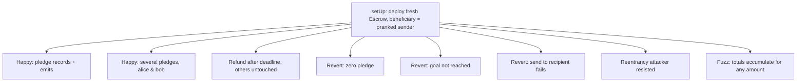

# Lesson 6 — Testing with Foundry

**Duration:** ~60 min · **Mode:** live-along, local Foundry
**Practice:** write a test suite for the `Escrow` running example.

## Objective

Establish test-driven habits using Solidity-native `forge test`. In an
immutable, adversarial environment, tests aren't a nicety — they're how you find
the bug *before* it's on-chain forever. Cover test harness types, assertions,
`setUp`, the core `vm` cheatcodes, expected reverts and events, time travel,
mocked failures, a reentrancy attack, gas reports, and a taste of fuzzing.

## Learning outcomes

Attendees can:

- Write and run tests with `forge test` and read `-vvv` traces.
- Use `setUp`, `assertEq`, and the `vm` cheatcodes `prank`, `deal`, `warp`,
  `expectRevert`, `expectEmit`, `mockCallRevert`.
- Test both happy paths and, crucially, revert paths (including custom errors).
- Test refunds after the deadline, a failing transfer, and reentrancy resistance.
- Name the three test harness paradigms and their trade-offs.
- Produce a gas report and understand what drives cost.

## Concept-before-tool

The tool is `forge test`. Frame it first: *"Tests are contracts too. Each
`test_*` function runs against a fresh deployment, so tests are isolated. The
`vm` object is a cheat panel that lets you impersonate accounts, hand out ETH,
and assert on reverts — things impossible on a real chain."*

## Timing

| Time    | Segment | Notes |
| ------- | ------- | ----- |
| 0:00–0:05 | Why test here matters | Immutable, transparent, adversarial, real money. |
| 0:05–0:09 | Test harness types | Fake EVM with cheatcodes, EVM emulator over RPC, testnet. |
| 0:09–0:17 | Anatomy of a test | `import Test`, `setUp`, `makeAddr`, `vm.prank`, happy path, `forge test` output. |
| 0:17–0:25 | Summing pledges | `alice` alone, then `alice` & `bob`; a failed test and how to read it. |
| 0:25–0:35 | Testing reverts + events | `expectRevert` with custom-error selectors + data, wrong-error report, `expectEmit`. |
| 0:35–0:47 | Deadline, refunds, failures | `vm.warp`, refund with others untouched, `vm.mockCallRevert` for a failing send. |
| 0:47–0:53 | Reentrancy | `ReentrancyAttacker` contract; move the state update after `call` and watch it fail. |
| 0:53–1:00 | Gas, fuzzing, recap + take-home | `--gas-report`; one `testFuzz_` example; what remains to test. |

## Talking points

- **Harness types.** Fake EVM with cheatcodes (fast, can simulate impossible
  states), EVM emulator tested by RPC (fast, only legal states), real testnet
  (slow, real delays). All are valuable.
- **Isolation.** `setUp()` re-runs before every test, so a fresh `Escrow` each
  time. No shared state, no order-dependence.
- **`vm.prank(addr)`** sets `msg.sender` for the *next* call — this is how you
  test per-backer logic (`alice`, `bob`) and to set the beneficiary when deploying
  in `setUp`. `vm.startPrank`/`vm.stopPrank` cover several calls.
  `vm.deal(addr, amount)` sets a balance, so an account can reach exactly `0`,
  which is only possible in the fake EVM.
- **Reverts are half the spec.** A contract's guarantees are as much about what
  it *rejects*. Match custom errors precisely — with data, use
  `abi.encodeWithSelector(Err.selector, args...)`. A wrong selector produces a
  failure message showing both the actual and expected error; read it.
- **Time.** `vm.warp(DEADLINE + 1)` moves the EVM clock. Mind the boundary: if
  the contract requires `deadline < block.timestamp`, `DEADLINE` alone is not enough.
- **Mocking failures.** `vm.mockCallRevert(alice, abi.encode(), "fakeReject")`
  makes the recipient reject the send, so the `SendFailed` path can be tested.
- **Reentrancy.** A `ReentrancyAttacker` re-enters `refund()` from `receive()`.
  Assert the escrow keeps `bob`'s funds. Moving `pledges[msg.sender] = 0` after
  the `call` makes the test fail, which proves the test is useful.
- **`expectEmit`.** Check topics, data and emitter. The boolean flags choose
  which parts to check (`indexed` fields are topics); pass `address(escrow)` to
  check the emitter. Then you "emit" the expected event right before the call.
- **Gas report.** `forge test --gas-report` shows per-function gas. Tie back to
  Lesson 2: storage writes dominate (`pledge` costs far more than reads). This is the "gas challenge" spirit from the
  online course.
- **Fuzzing.** Give a parameter to a `testFuzz_*` function and Foundry throws
  hundreds of random inputs at it. `vm.assume` filters invalid ones.

## The tests

See [`code/test/Escrow.t.sol`](./code/test/Escrow.t.sol). It assumes the
`Escrow.sol` solution from Lesson 5 sits in `src/`. Run:

```bash
forge test -vvv
forge test --gas-report
```

## Test map



## What remains to test

- Deadline in the past at construction.
- Pledge after deadline.
- Withdraw (send to beneficiary) after deadline or before goal.
- Beneficiary rejects send.
- Refund when no pledge.

## Hands-on

Copy the test file into `test/`, run `forge test -vvv`, then deliberately break
the contract (e.g. move the state update after the `call` in `refund`, or remove
the goal check) and watch a test go red.

## Take-home

Reach full coverage of your `Escrow`, including the `setGoalReachedMessage`
function you added in Lesson 5. Add at least one test that would fail if the
`goal` check were removed. Next lesson: we break it on purpose.

## Common pitfalls

- Forgetting `vm.prank` only affects the very next call (a second pledge by
  `alice` needs its own prank).
- Warping to exactly the deadline when the contract needs strictly after.
- Matching a custom error by name only when it carries data — use the encoded form.
- Testing only happy paths (the most common real-world gap).

## Success check

A green suite for `Escrow` plus a gas report the attendee can read and explain.
