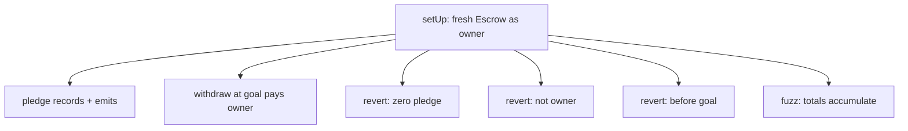

# Testing with Foundry

### Because on-chain bugs are forever 💍

Lesson 6 · Ethereum & Solidity for developers

---

# Why testing matters *more* here

<v-clicks>

- **Immutable** — can't hotfix deployed code.
- **Transparent** - code is there for all to see.
- **Adversarial** — someone is paid to break it.
- **Real money** — the bug has a bounty on it.

</v-clicks>
<v-clicks>

Tests are how you find it *before* it's on-chain.

https://pastebin.com/DYsXeUtJ

https://pastebin.com/dDdSUBVk

</v-clicks>

---

# Test harness types

A smart contract can be tested under various paradigms.

<v-clicks depth="2">

- Deployed by another smart contract. In a fake EVM with cheat codes.
  - Fast. 👍
  - Simulation of impossible states. 👍
- Deployed in an EVM emulator and tested by RPC.
  - Fast. 👍
  - State arrived at by legal EVM commands and contract execution.
- Deployed in a real blockchain and tested by RPC. Testnet.
  - Slow. Real delay effects. 👍
- All of them are valuable.

</v-clicks>

<!--
- Historically, it started from real, then emulator, then fake EVM.
- Foundry has cheat codes.
-->

---

# Solidity tests as contracts

````md magic-move [Escrow.t.sol]
```solidity
pragma solidity ^0.8.34;

import {Test} from "forge-std/Test.sol";
import {Escrow} from "../src/Escrow.sol";
```
```solidity
import {Test} from "forge-std/Test.sol";
import {Escrow} from "../src/Escrow.sol";

contract EscrowTest is Test {
    function setUp() public {
    }
}
```
```solidity
import {Test} from "forge-std/Test.sol";
import {Escrow} from "../src/Escrow.sol";

contract EscrowTest is Test {
    Escrow escrow;

    function setUp() public {
        escrow = new Escrow(10 ether, 2791209136); // fresh before EVERY test
    }
}
```
```solidity
import {Test} from "forge-std/Test.sol";
import {Escrow} from "../src/Escrow.sol";

contract EscrowTest is Test {
    Escrow escrow;
    address beneficiary = makeAddr("beneficiary");

    function setUp() public {
        vm.prank(beneficiary);
        escrow = new Escrow(10 ether, 2791209136);
    }
}
```
````

<v-clicks at="2" depth="2">

- Who is the beneficiary (`msg.sender`) of the escrow instance?
- `vm` gives access to the [cheat codes](https://www.getfoundry.sh/reference/cheatcodes/overview) of the fake EVM.
- [`vm.prank`](https://www.getfoundry.sh/reference/cheatcodes/prank) is changing `msg.sender` on the next call **only**.
  - [`vm.startPrank`](https://www.getfoundry.sh/reference/cheatcodes/start-prank) for all calls until [`vm.stopPrank`](https://www.getfoundry.sh/reference/cheatcodes/stop-prank).

</v-clicks>

<!--
- [click:2] Smart contract that deploys another is `msg.sender`.
- [click]
-->

---

# The `vm` cheat panel

Things impossible on a real chain:

<v-clicks>

- `vm.prank(addr)` — be someone else for the next call.
- `vm.deal(addr, amount)` — set ETH balance.
- `vm.expectRevert(...)` — assert a failure.
- `vm.expectEmit(...)` — assert an event.

</v-clicks>

---

# Happy path

````md magic-move
```solidity
function test_Pledge_RecordsDeposit() public {
    vm.deal(alice, 1 ether);
    vm.prank(alice);
    escrow.pledge{value: 1 ether}();
}
```
```solidity
function test_Pledge_RecordsDeposit() public {
    vm.deal(alice, 1 ether);
    vm.prank(alice);
    escrow.pledge{value: 1 ether}();

    assertEq(escrow.pledges(alice), 1 ether);
}
```
```solidity
function test_Pledge_RecordsDeposit() public {
    vm.deal(alice, 1 ether);
    vm.prank(alice);
    escrow.pledge{value: 1 ether}();

    assertEq(escrow.pledges(alice), 1 ether);
    assertEq(escrow.totalPledged(), 1 ether);
}
```
```solidity
function test_Pledge_RecordsDeposit() public {
    vm.deal(alice, 1 ether);
    vm.prank(alice);
    escrow.pledge{value: 1 ether}();

    assertEq(escrow.pledges(alice), 1 ether);
    assertEq(escrow.totalPledged(), 1 ether);
    assertEq(address(escrow).balance, 1 ether);
}
```
```solidity
function test_Pledge_RecordsDeposit() public {
    vm.deal(alice, 1 ether);
    vm.prank(alice);
    escrow.pledge{value: 1 ether}();

    assertEq(escrow.pledges(alice), 1 ether);
    assertEq(escrow.totalPledged(), 1 ether);
    assertEq(address(escrow).balance, 1 ether);
    assertEq(address(alice).balance, 0 ether);
}
```
````

<v-clicks at="4">

- Getting to `0` only possible in fake EVM.

</v-clicks>

---

# Launch tests

````md magic-move
```bash
forge test
```
```bash
forge test

[⠊] Compiling...
[⠰] Compiling 1 files with Solc 0.8.37
[⠔] Solc 0.8.37 finished in 342.29ms
Compiler run successful!

Ran 1 test for test/Escrow.t.sol:EscrowTest
[PASS] test_Pledge_RecordsDeposit() (gas: 106923)
Suite result: ok. 1 passed; 0 failed; 0 skipped; finished in 386.25µs (49.17µs CPU time)

Ran 1 test suite in 4.84ms (386.25µs CPU time): 1 tests passed, 0 failed, 0 skipped (1 total tests)
```
````

---

# Test summing pledges, `alice`

```solidity
function test_Pledge_SumsDeposit() public {
    vm.deal(alice, 0.8 ether); // give alice some ETH
    vm.prank(alice);
    escrow.pledge{value: 0.2 ether}();
    vm.prank(alice); // Don't forget
    escrow.pledge{value: 0.3 ether}();

    assertEq(escrow.pledges(alice), 0.5 ether);
    assertEq(escrow.totalPledged(), 0.5 ether);
    assertEq(address(escrow).balance, 0.5 ether);
    assertEq(address(alice).balance, 0.3 ether);
}
```

---

# Test pledges, `alice` & `bob`

````md magic-move
```solidity
function test_Pledge_TwoDeposit() public {
    vm.deal(alice, 0.8 ether); // give alice some ETH
    vm.prank(alice);
    escrow.pledge{value: 0.2 ether}();

    assertEq(escrow.pledges(alice), 0.2 ether);
    assertEq(address(alice).balance, 0.6 ether);
    assertEq(address(escrow).balance, 0.2 ether);
    assertEq(escrow.totalPledged(), 0.2 ether);
}
```
```solidity
function test_Pledge_TwoDeposit() public {
    vm.deal(alice, 0.8 ether); // give alice some ETH
    vm.prank(alice);
    escrow.pledge{value: 0.2 ether}();
    vm.deal(bob, 0.7 ether); // give bob some ETH
    vm.prank(bob);
    escrow.pledge{value: 0.3 ether}();

    assertEq(escrow.pledges(alice), 0.2 ether);
    assertEq(address(alice).balance, 0.6 ether);
    assertEq(escrow.pledges(bob), 0.3 ether);
    assertEq(address(bob).balance, 0.4 ether);
    assertEq(escrow.totalPledged(), 0.5 ether);
    assertEq(address(escrow).balance, 0.5 ether);
}
```
````

---

# Example failed test

What does it look like.

````md magic-move
```solidity
assertEq(address(alice).balance, 0 ether);
```
```solidity
assertEq(address(alice).balance, 0.1 ether);
```
````

<v-clicks>

With this forced error:

````md magic-move
```bash
forge test
```
```bash
forge test

Ran 1 test for test/Escrow.t.sol:EscrowTest
[FAIL: assertion failed: 0 != 100000000000000000] test_Pledge_RecordsDeposit() (gas: 110008)
Suite result: FAILED. 0 passed; 1 failed; 0 skipped; finished in 1.90ms (1.10ms CPU time)
```
````

</v-clicks>

---

# Test a `require` failure mode

Match the error precisely

````md magic-move
```solidity
function test_Pledge_Reverts_OnZeroValue() public {
    vm.prank(alice);
    vm.expectRevert();
    escrow.pledge{value: 0}();
}
```
```solidity
function test_Pledge_Reverts_OnZeroValue() public {
    vm.prank(alice);
    vm.expectRevert(abi.encodeWithSelector(Escrow.ZeroPledge.selector, alice));
    escrow.pledge{value: 0}();
}
```
````

<v-clicks>

Custom error **with data**? Match it precisely:

```solidity
vm.expectRevert(
  abi.encodeWithSelector(Escrow.GoalNotReached.selector, 1 ether, 10 ether)
);
```

</v-clicks>

<!--
- Not talking about failed test.
- Talking about a passing test that confirms an expected `revert` from a `require`.
-->

---

# Tested wrong error

Understand encoding and error report

````md magic-move
```solidity
vm.expectRevert(abi.encodeWithSelector(Escrow.ZeroPledge.selector, alice));
```
```solidity
vm.expectRevert(abi.encodeWithSelector(Escrow.GoalNotReached.selector, alice));
```
````

<v-clicks>

When run:

````md magic-move
```bash
forge test
```
```bash
forge test

FAIL: Error != expected error: ZeroPledge(0x328809Bc894f92807417D2dAD6b7C998c1aFdac6) != 
    custom error 0x29f02334: 000000000000000000000000328809bc894f92807417d2dad6b7c998c1afdac6] 
    test_Pledge_Reverts_OnZeroValue() (gas: 33116)
```
````

</v-clicks>

---

# Test emitted event

Check topics, data and emitter

````md magic-move
```solidity
function test_Pledge_EmitsEvent() public {
    vm.deal(alice, 1 ether);

    // Expect the exact event.
    vm.expectEmit();
    emit Escrow.Pledged(alice, 1 ether);

    vm.prank(alice);
    escrow.pledge{value: 1 ether}();
}
```
```solidity
function test_Pledge_EmitsEvent() public {
    vm.deal(alice, 1 ether);

    // Expect an event, check emitter.
    vm.expectEmit(address(escrow));
    emit Escrow.Pledged(alice, 1 ether);

    vm.prank(alice);
    escrow.pledge{value: 1 ether}();
}
```
```solidity
function test_Pledge_EmitsEvent() public {
    vm.deal(alice, 1 ether);

    // Expect an event, check parts.
    vm.expectEmit(true, false, false, true, address(escrow));
    emit Escrow.Pledged(alice, 1 ether);

    vm.prank(alice);
    escrow.pledge{value: 1 ether}();
}
```
````

<v-clicks at="2">

- `indexed` field is checked in topics.

</v-clicks>

---

# Test deadline passed

Move EVM to the future


````md magic-move
```solidity
function test_Refund_WhenDeadlinePassed() public {
    vm.deal(alice, 0.8 ether); // give alice some ETH
    vm.prank(alice);
    escrow.pledge{value: 0.2 ether}();
}
```
```solidity
function test_Refund_WhenDeadlinePassed() public {
    vm.deal(alice, 0.8 ether); // give alice some ETH
    vm.prank(alice);
    escrow.pledge{value: 0.2 ether}();

    vm.warp(DEADLINE); // Exactly?
}
```
```solidity
function test_Refund_WhenDeadlinePassed() public {
    vm.deal(alice, 0.8 ether); // give alice some ETH
    vm.prank(alice);
    escrow.pledge{value: 0.2 ether}();

    vm.warp(DEADLINE + 1); // No, it is require(deadline < block.timestamp...
}
```
```solidity
function test_Refund_WhenDeadlinePassed() public {
    vm.deal(alice, 0.8 ether); // give alice some ETH
    vm.prank(alice);
    escrow.pledge{value: 0.2 ether}();

    vm.warp(DEADLINE + 1);
    vm.prank(alice);
    escrow.refund();
}
```
```solidity
function test_Refund_WhenDeadlinePassed() public {
    vm.deal(alice, 0.8 ether); // give alice some ETH
    vm.prank(alice);
    escrow.pledge{value: 0.2 ether}();

    vm.warp(DEADLINE + 1);
    vm.prank(alice);
    escrow.refund();

    assertEq(escrow.pledges(alice), 0 ether);
    assertEq(escrow.totalPledged(), 0 ether);
    assertEq(address(escrow).balance, 0 ether);
    assertEq(address(alice).balance, 0.8 ether);
}
```
````

---

# Test refund, `alice` & `bob`

Others untouched

````md magic-move
```solidity
function test_Refund_WhenDeadlinePassed() public {
    vm.deal(alice, 0.8 ether);
    vm.prank(alice);
    escrow.pledge{value: 0.2 ether}();
    vm.deal(bob, 0.7 ether);
    vm.prank(bob);
    escrow.pledge{value: 0.3 ether}();
}
```
```solidity
function test_Refund_WhenDeadlinePassed() public {
    vm.deal(alice, 0.8 ether);
    vm.prank(alice);
    escrow.pledge{value: 0.2 ether}();
    vm.deal(bob, 0.7 ether);
    vm.prank(bob);
    escrow.pledge{value: 0.3 ether}();

    vm.warp(DEADLINE + 1);
    vm.prank(alice);
    escrow.refund();
}
```
```solidity
function test_Refund_WhenDeadlinePassed() public {
    vm.deal(alice, 0.8 ether);
    vm.prank(alice);
    escrow.pledge{value: 0.2 ether}();
    vm.deal(bob, 0.7 ether);
    vm.prank(bob);
    escrow.pledge{value: 0.3 ether}();

    vm.warp(DEADLINE + 1);
    vm.prank(alice);
    escrow.refund();

    assertEq(escrow.pledges(alice), 0 ether);
    assertEq(address(alice).balance, 0.8 ether);
    assertEq(escrow.pledges(bob), 0.3 ether);
    assertEq(address(bob).balance, 0.4 ether);
    assertEq(escrow.totalPledged(), 0.3 ether);
    assertEq(address(escrow).balance, 0.3 ether);
}
```
````

---

# Test refund transfer fails

```solidity [Escrow.sol / refund()]
(bool ok,) = msg.sender.call{value: amount}("");
require(ok, SendFailed(msg.sender));
```

````md magic-move
```solidity
function test_Refund_Fails_WhenReject() public {
    vm.deal(alice, 0.8 ether); // give alice some ETH
    vm.prank(alice);
    escrow.pledge{value: 0.2 ether}();
    vm.warp(DEADLINE + 1);

    vm.prank(alice);
    escrow.refund();
}
```
```solidity
function test_Refund_Fails_WhenReject() public {
    vm.deal(alice, 0.8 ether); // give alice some ETH
    vm.prank(alice);
    escrow.pledge{value: 0.2 ether}();
    vm.warp(DEADLINE + 1);

    vm.prank(alice);
    vm.mockCallRevert(alice, abi.encode(), "fakeReject");
    escrow.refund();
}
```
```solidity
function test_Refund_Fails_WhenReject() public {
    vm.deal(alice, 0.8 ether); // give alice some ETH
    vm.prank(alice);
    escrow.pledge{value: 0.2 ether}();
    vm.warp(DEADLINE + 1);

    vm.prank(alice);
    vm.mockCallRevert(alice, abi.encode(), "fakeReject");
    vm.expectRevert(abi.encodeWithSelector(SendFailed.selector, alice));
    escrow.refund();
}
```
```solidity
function test_Refund_Fails_WhenReject() public {
    vm.deal(alice, 0.8 ether); // give alice some ETH
    vm.prank(alice);
    escrow.pledge{value: 0.2 ether}();
    vm.warp(DEADLINE + 1);

    vm.prank(alice);
    vm.mockCallRevert(alice, abi.encode(), "fakeReject");
    vm.expectRevert(abi.encodeWithSelector(SendFailed.selector, alice));
    escrow.refund();

    assertEq(escrow.pledges(alice), 0.2 ether);
    assertEq(escrow.totalPledged(), 0.2 ether);
    assertEq(address(escrow).balance, 0.2 ether);
    assertEq(address(alice).balance, 0.6 ether);
}
```
````

---

# Test reentrancy

With an attacker

<span v-if="$clicks <= 3">

````md magic-move
```solidity
contract ReentrancyAttacker {
    receive() external payable {
    }
}
```
```solidity
contract ReentrancyAttacker {
    receive() external payable {
        if (msg.value <= msg.sender.balance) {
        }
    }
}
```
```solidity
contract ReentrancyAttacker {
    receive() external payable {
        if (msg.value <= msg.sender.balance) {
            (bool ok, ) = msg.sender.call(abi.encodeWithSelector(Escrow.refund.selector));
        }
    }
}
```
````

</span>
<span v-if="$clicks >= 3">

````md magic-move
```solidity
function test_Resists_OnReentrancy() public {
    ReentrancyAttacker attacker = new ReentrancyAttacker();
    vm.deal(address(attacker), 0.2 ether); // give attacker some ETH
    vm.prank(address(attacker));
    escrow.pledge{value: 0.2 ether}();
}
```
```solidity
function test_Resists_OnReentrancy() public {
    ReentrancyAttacker attacker = new ReentrancyAttacker();
    vm.deal(address(attacker), 0.2 ether);
    vm.prank(address(attacker));
    escrow.pledge{value: 0.2 ether}();
    vm.deal(bob, 0.7 ether); // give bob some ETH
    vm.prank(bob);
    escrow.pledge{value: 0.3 ether}(); // Hoping to steal from Bob
}
```
```solidity
function test_Resists_OnReentrancy() public {
    ReentrancyAttacker attacker = new ReentrancyAttacker();
    vm.deal(address(attacker), 0.2 ether);
    vm.prank(address(attacker));
    escrow.pledge{value: 0.2 ether}();
    vm.deal(bob, 0.7 ether);
    vm.prank(bob);
    escrow.pledge{value: 0.3 ether}();

    vm.warp(DEADLINE + 1);
    vm.prank(address(attacker));
    escrow.refund();
}
```
```solidity
function test_Resists_OnReentrancy() public {
    ReentrancyAttacker attacker = new ReentrancyAttacker();
    vm.deal(address(attacker), 0.2 ether);
    vm.prank(address(attacker));
    escrow.pledge{value: 0.2 ether}();
    vm.deal(bob, 0.7 ether);
    vm.prank(bob);
    escrow.pledge{value: 0.3 ether}();

    vm.warp(DEADLINE + 1);
    vm.prank(address(attacker));
    escrow.refund();

    assertEq(address(escrow).balance, 0.3 ether);
    assertEq(address(attacker).balance, 0.2 ether);
}
```
````

</span>
<v-clicks at="6" depth="2">

- What if move `pledges[msg.sender] = 0;` after `call`?
  - `[FAIL: assertion failed: 100000000000000000 != 300000000000000000] test_Resists_OnReentrancy() (gas: 397831)`

</v-clicks>


---
hide: true
---

# What are we testing?



---

# What remains to test

- Deadline in the past at construction.
- Pledge after deadline.
- Withdraw after deadline or before goal.
- Beneficiary rejects send.
- Refund when no pledge.

---

# Fuzzing

```solidity
function testFuzz_Pledge(uint96 amount) public {
    vm.assume(0 < amount);
    vm.deal(alice, amount);
    vm.prank(alice);
    escrow.pledge{value: amount}();
    assertEq(escrow.totalPledged(), amount);
}
```

Hundreds of random inputs, automatically.

---

# Gas

````md magic-move
```bash
forge test --gas-report
```
```bash
forge test --gas-report      # storage writes dominate

╭--------------------------------+-----------------+-------+--------+-------+---------╮
| src/Escrow.sol:Escrow Contract |                 |       |        |       |         |
+=====================================================================================+
| Deployment Cost                | Deployment Size |       |        |       |         |
|--------------------------------+-----------------+-------+--------+-------+---------|
|                              0 |            2886 |       |        |       |         |
|--------------------------------+-----------------+-------+--------+-------+---------|
|                                |                 |       |        |       |         |
|--------------------------------+-----------------+-------+--------+-------+---------|
| Function Name                  | Min             | Avg   | Median | Max   | # Calls |
|--------------------------------+-----------------+-------+--------+-------+---------|
| pledge                         |           21507 | 67170 |  67716 | 67716 |     273 |
|--------------------------------+-----------------+-------+--------+-------+---------|
| pledges                        |            2825 |  2825 |   2825 |  2825 |     265 |
|--------------------------------+-----------------+-------+--------+-------+---------|
| refund                         |           39130 | 40455 |  40400 | 41893 |       4 |
|--------------------------------+-----------------+-------+--------+-------+---------|
| sendToBeneficiary              |           21540 | 26091 |  26091 | 30643 |       2 |
|--------------------------------+-----------------+-------+--------+-------+---------|
| totalPledged                   |            2447 |  2447 |   2447 |  2447 |     263 |
╰--------------------------------+-----------------+-------+--------+-------+---------╯
```
````

---
layout: center
---

## Take-home

Full coverage of your `Escrow`,
including last lesson's `setGoalReachedMessage`.

Add one test that **fails if the goal check is removed.**

Next lesson: we break it on purpose.
