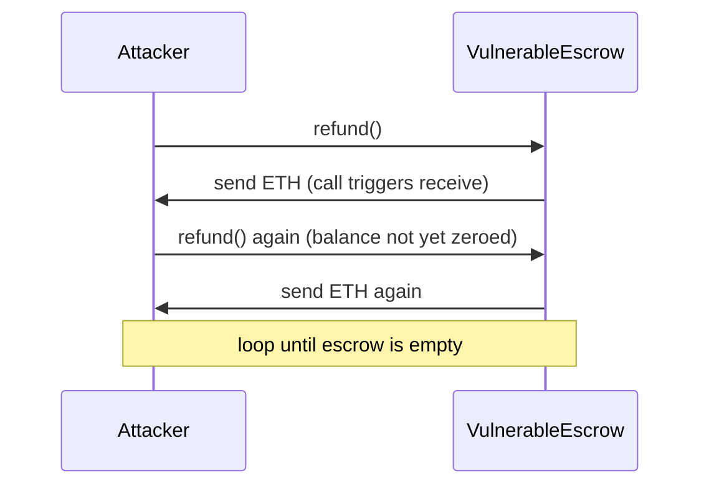

# Lesson 7 — Security (the dedicated lesson)

**Duration:** ~60 min · **Mode:** live exploit + fix, local Foundry
**Practice:** attendees exploit a vulnerable contract, then patch it and re-run.

## Objective

The priority lesson. Make the danger visceral: run a **working re-entrancy
exploit** that drains a contract, then fix it two independent ways and prove the
attack now fails. Survey the other vulnerability classes and instil the habits
that prevent most incidents.

## Learning outcomes

Attendees can:

- Explain re-entrancy and recognise the vulnerable pattern (interaction before
  effect).
- Exploit it with an attacker contract and prove the drain with a test.
- Fix it via Checks-Effects-Interactions and a `nonReentrant` guard.
- Name the other big classes (access control, unchecked calls, push-vs-pull,
  oracle/front-running) and the habits that mitigate them.

## Concept-before-tool

The "tool" additions are OpenZeppelin's `ReentrancyGuard` and (mentioned) static
analysers like `slither`. Introduce OpenZeppelin as the field's standard,
audited building blocks — *"don't roll your own guards or crypto."* Introduce the
guard only after the class has seen the raw bug and the manual fix, so they
understand what it's doing.

## Timing

| Time    | Segment | Notes |
| ------- | ------- | ----- |
| 0:00–0:05 | Stakes | Immutable + public + valuable = adversarial. |
| 0:05–0:12 | Re-entrancy explained | The DAO story; control transfer on external call. |
| 0:12–0:20 | Spot the bug | Walk `VulnerableEscrow.refund` — call before state update. |
| 0:20–0:32 | Run the exploit | `Attacker` drains it; the test goes green (= exploit works). |
| 0:32–0:42 | Fix it | Checks-Effects-Interactions; then `nonReentrant`; re-run → attack reverts. |
| 0:42–0:52 | Other classes | Access control, unchecked calls, pull-over-push, oracle/front-running. |
| 0:52–0:58 | Habits & tooling | OpenZeppelin, test reverts, audits, `slither`. |
| 0:58–1:00 | Take-home | Honeypot challenge. |

## Talking points

- **Why it happens.** `addr.call{value: x}("")` executes the *recipient's* code.
  If that recipient is a contract, it can call back into you before your state
  settled. The vulnerable `refund` sends first and zeroes the balance last, so
  the re-entrant call still sees a non-zero balance.
- **Prove, don't assert.** The exploit is a passing test that leaves the escrow
  at zero balance and the attacker richer than its deposit. Seeing green sell it.
- **Checks-Effects-Interactions.** Order every state-changing function:
  validate → update your state → *then* touch the outside world. This alone kills
  the bug.
- **Defense in depth.** `nonReentrant` is a cheap lock; use it *and* CEI. Prefer
  OpenZeppelin's audited version over a hand-rolled boolean.
- **Pull over push.** The online course's "one at a time" / withdrawal pattern:
  let each user withdraw their own funds rather than looping to pay everyone —
  avoids both re-entrancy and gas-griefing. Tie back to the Lesson 5 `Escrow`
  and note how you'd re-model refunds there.
- **Other classes, briefly.** Missing access control (anyone calls admin fns),
  ignoring a `call`'s returned bool, oracle/price manipulation, and
  front-running. Name them so the vocabulary exists; depth is for later study.
- **Tooling.** `forge` invariant tests and `slither` static analysis; and the
  cultural norm of getting audited before shipping real value.

## The code

In [`code/`](./code/), set up as a Foundry project (`src/` + `test/`) with
OpenZeppelin installed (`forge install OpenZeppelin/openzeppelin-contracts`):

- [`src/VulnerableEscrow.sol`](./code/src/VulnerableEscrow.sol) — the bug.
- [`src/Attacker.sol`](./code/src/Attacker.sol) — the exploit contract.
- [`src/SafeEscrow.sol`](./code/src/SafeEscrow.sol) — CEI + `nonReentrant`.
- [`test/Reentrancy.t.sol`](./code/test/Reentrancy.t.sol) — proves the attack
  drains the vulnerable one and fails against the safe one.

```bash
forge install OpenZeppelin/openzeppelin-contracts
forge test -vvv
```

## The attack (also in slides)



## Hands-on

Run the exploit test and watch it pass (the drain). Then switch the target to
`SafeEscrow` and watch the attack revert. Optionally, have attendees *introduce*
the fix themselves into a copy of `VulnerableEscrow` and re-run.

## Take-home: honeypot challenge

Give attendees a contract that appears to offer free ETH but traps anyone who
tries to take it (adapted from the online course's honeypot). They must find the
trap by reading the external calls, and write a test that proves it, *without*
losing (test) funds.

## Common pitfalls

- Believing `transfer`/`send` (2300 gas) makes you safe — it doesn't, in general.
- Fixing with CEI but leaving another interaction-before-effect elsewhere.
- Treating the guard as a substitute for correct ordering rather than a backup.

## Success check

A re-entrancy exploit that **succeeds** against the naive contract and **fails**
against the fixed one, both demonstrated by passing tests.
