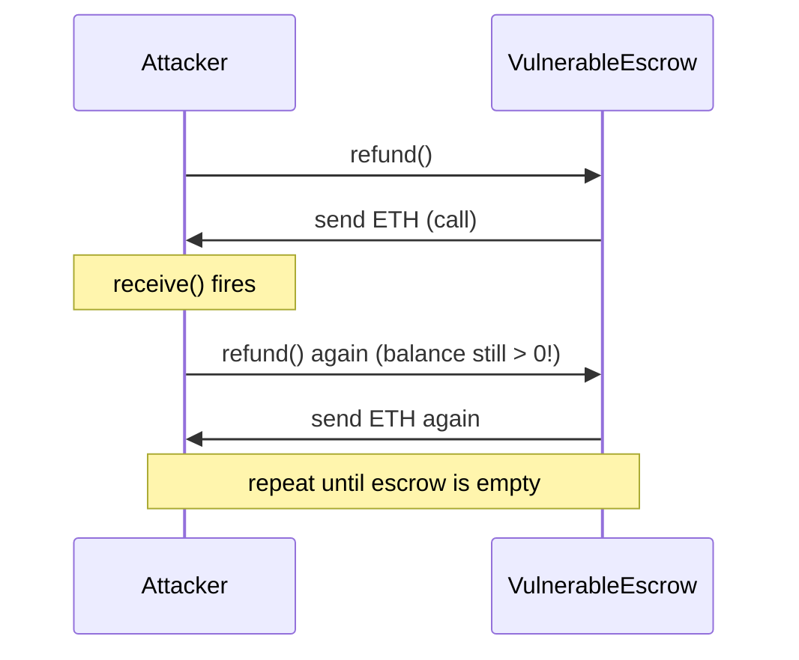

# Security

### We break a contract on purpose, then fix it

Lesson 7 · Ethereum & Solidity for developers

---

## The stakes

- Code is **immutable** — no patch after deploy.
- State is **public** — attackers read everything.
- Value is **at stake** — the bug pays.

Today is the most important lesson. We *exploit*, then *defend*.

---

## The classic: re-entrancy

The bug that drained The DAO (2016) and still bites today.

Cause: an external call hands control to *someone else* **before** you finish
updating your own state.

---

## Spot the bug

```solidity
function refund() external {
    uint256 amount = balances[msg.sender];
    require(amount > 0, "nothing to refund");

    (bool ok, ) = msg.sender.call{value: amount}(""); // ❌ call first
    require(ok, "transfer failed");

    balances[msg.sender] = 0;                          // ❌ update last
}
```

The `call` runs the caller's code — *before* the balance is zeroed.

---

## The attack loop



---

## Prove it with a test

```solidity
function test_Attack_Drains_Vulnerable() public {
    // two honest backers deposit 10 ETH total
    // attacker seeds 1 ETH, re-enters
    assertEq(address(escrow).balance, 0);        // drained
    assertGt(address(attacker).balance, 1 ether); // profit
}
```

Green test = working exploit. Run it live.

---

## Fix 1 — Checks-Effects-Interactions

```solidity
function refund() external {
    uint256 amount = balances[msg.sender]; // Checks
    require(amount > 0, "nothing to refund");

    balances[msg.sender] = 0;              // Effects (BEFORE the call)

    (bool ok, ) = msg.sender.call{value: amount}(""); // Interactions
    require(ok, "transfer failed");
}
```

Re-entering now sees a zero balance. Attack dies.

---

## Fix 2 — a guard (defense in depth)

```solidity
import {ReentrancyGuard} from
  "@openzeppelin/contracts/utils/ReentrancyGuard.sol";

contract SafeEscrow is ReentrancyGuard {
    function refund() external nonReentrant { ... }
}
```

Same attack now **reverts**. Prefer audited libraries over hand-rolled locks.

---

## Other classes to know

- **Access control** — who can call what? (`onlyOwner`, roles)
- **Unchecked external calls** — always handle the returned `bool`.
- **Pull over push** — let users *withdraw*, don't loop paying them out.
- **Oracle / price manipulation**, front-running — name them, flag for later.

---

## Habits that prevent most of this

- Checks-Effects-Interactions, always.
- Use **OpenZeppelin**; don't roll your own crypto or guards.
- Test the **revert paths** (Lesson 6).
- Get an **audit** before real value. Tools: `slither`, `forge` invariants.

---
layout: center
---

## Take-home: honeypot challenge

A contract that *looks* safe and *looks* like free money.

Find the trap before you'd send ETH.
Write the test that proves it.

(Hint: read every external call and ask "who runs next?")
