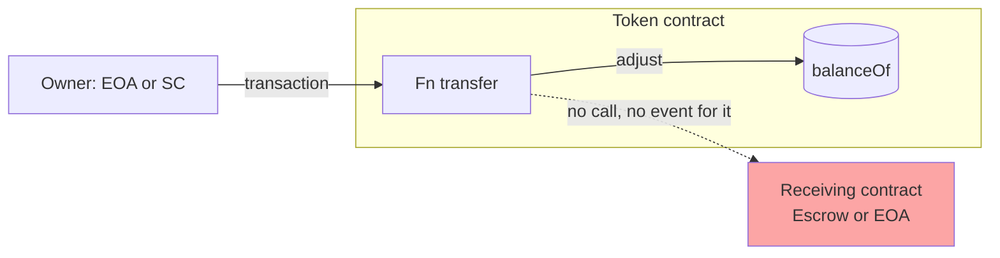
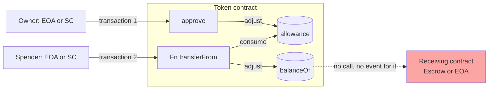
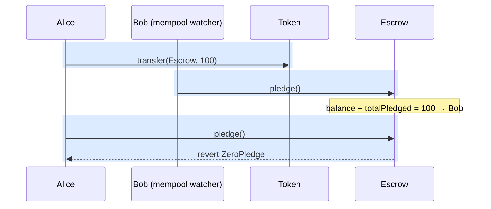
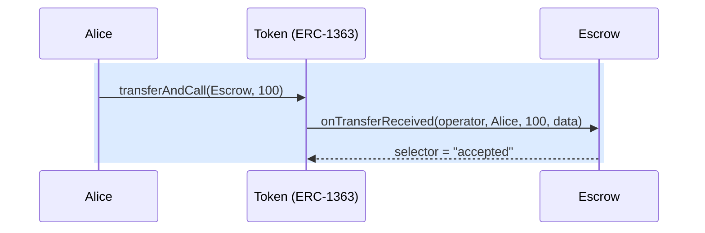
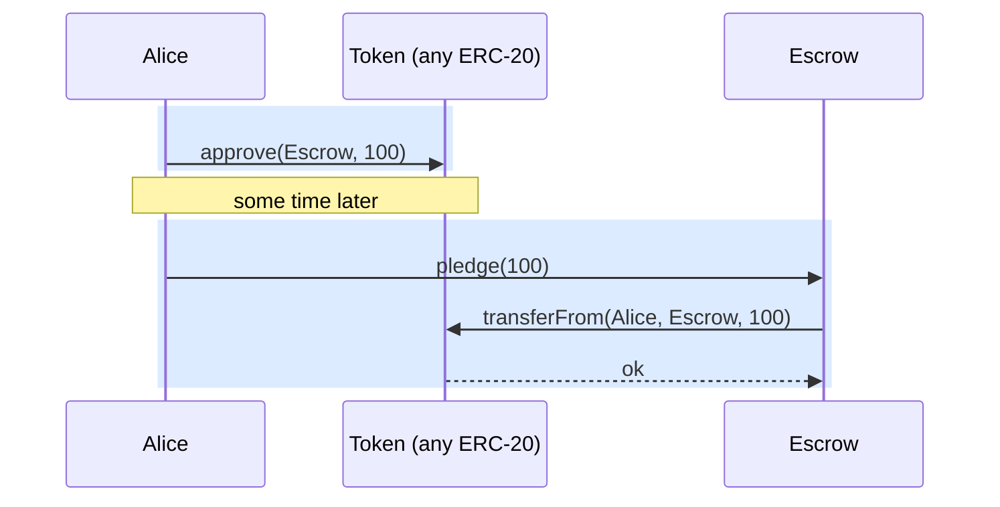
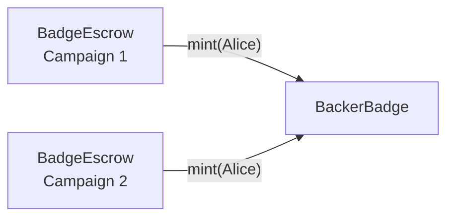

# Token standards

### ERC-20 & ERC-721 — rebuilding the Escrow on a stable token

Lesson 8 · Ethereum & Solidity for developers

<!--
- Today we go back to our `Escrow` from Lesson 5.
- We change it a few times, and we change the Foundry tests from Lesson 6 each time.
- Then we hand out NFT badges to backers.
-->

---

# Where we left the Escrow

Lesson 5, ETH version

<v-clicks>

- Backers send **ETH** — `payable`, `msg.value`
- Goal is a number of **wei**
- Refund and payout use a low-level `call`
- What is wrong with a crowdfunding goal expressed in ETH?

</v-clicks>

<div v-if="$clicks < 3">

```solidity
function pledge() external payable {
    require(0 < msg.value, ZeroPledge(msg.sender));
    require(totalPledged < goal, GoalReached(msg.sender));
    require(block.timestamp <= deadline, DeadlinePassed(msg.sender));
    pledges[msg.sender] += msg.value;
    totalPledged += msg.value;
    emit Pledged(msg.sender, msg.value);
}
```

</div>
<div v-else>

```solidity
function refund() external {
    uint256 amount = pledges[msg.sender];
    require(0 < amount, ZeroPledge(msg.sender));
    require(deadline < block.timestamp, DeadlineNotPassed(msg.sender));
    pledges[msg.sender] = 0;
    totalPledged -= amount;
    (bool ok,) = msg.sender.call{value: amount}("");
    require(ok, SendFailed(msg.sender));
    emit Refunded(msg.sender, amount);
}
```

</div>

<!--
- Quick recap, nobody should be surprised by this code.
- [click] Value comes in with the call.
- [click] The goal is in wei.
- [click] Money goes out with `call`, and we spent Lesson 7 on why that is delicate.
- The snippet swaps from `pledge()` to `refund()` to show the `call`.
-->

---

## Today's problem

Ether is volatile

<v-clicks>

- **Goal** — `10 ether` is worth a different amount every week
- **January** — backers pledge, ETH is high
- **March** — campaign closes, ETH is down 30% → beneficiary cannot pay the bills 😅
- **Wanted** — a goal in something **stable**: USDC, DAI...
- **Catch** — a token is not ETH. It is *another contract* tracking balances. → standards

</v-clicks>

<!--
- Real example: 10 ETH was around 15k dollars at some points and 40k at others.
- [click:4] Stablecoins try to track a currency.
- Who knows how they do it? Collateral, algorithms, a company with a bank account.
- Not our topic today.
- [click] Key point: no `msg.value` for tokens. The Escrow will have to talk to the token contract.
- That is what standards are for.
-->

---
layout: section
---

# 1. What is an ERC?

Rules everybody agreed to follow

---

# EIP, ERC

<v-clicks>

- **EIP** — Ethereum Improvement Proposal. Public, on GitHub.
- **ERC** — the application-level category. How contracts *should look*.
- **Lifecycle** — Draft → Review → Last Call → Final
- **Number** — ERC-20 is proposal #20. Not "20th token".
- **Not enforced** by the chain: a social contract: ~~trust~~ **interface + expected behaviour**.

</v-clicks>

<!--
- [click] Core protocol changes are EIPs too (EIP-1559 for fees).
- [click] ERCs are the ones that do not touch consensus.
- [click:2] ERC-20 was written by Fabian Vogelsteller in 2015. Became final in 2017.
- [click] The standard says what the functions return and which events fire. Behaviour matters as much as signatures.
- Nobody stops you from writing a token that does not follow ERC-20. Nobody will use it.
-->

---

## Standards you will meet

| ERC | Standardises |
| --- | --- |
| **ERC-20** | Fungible tokens: currencies, stablecoins, points |
| **ERC-721** | Non-fungible tokens: unique items |
| **ERC-1155** | Many token types in one contract |
| **ERC-4626** | Tokenised vaults |
| **ERC-165** | "Do you support interface X?" |
| **ERC-2612** | `permit`: approve with a signature |

<v-clicks>

- What do all of these have in common?

</v-clicks>

<!--
- Today: ERC-20, ERC-721, and ERC-165. The others are for your curiosity.
- ERC-165 is how a contract announces which interface it supports. Wallets use it to detect NFTs.
- [click] A shared interface so tools do not need to know your contract.
-->

---

# ERC-20

The [interface](https://github.com/OpenZeppelin/openzeppelin-contracts/blob/master/contracts/token/ERC20/IERC20.sol)

```solidity
function totalSupply() external view returns (uint256);
// mapping(address => uint256)
function balanceOf(address account) external view returns (uint256);
function transfer(address to, uint256 value) external returns (bool);
// mapping(address => mapping (address => uint256))
function allowance(address owner, address spender) external view returns (uint256);
function approve(address spender, uint256 value) external returns (bool);
function transferFrom(address from, address to, uint256 value) external returns (bool);

event Transfer(address indexed from, address indexed to, uint256 value);
event Approval(address indexed owner, address indexed spender, uint256 value);
```

<v-clicks>

- *Optional: `name()`, `symbol()`, `decimals()`.*
- See parallels with Ether balance.

</v-clicks>

<!--
- Six functions, two events. That is the whole standard.
- A token is just a `mapping(address => uint256)` plus rules to move it around.
- `Transfer` is how explorers and wallets index balances. If you forget the event, you are invisible.
- [click] Optional metadata is optional in the spec, but everybody has it.
- [click] Balance. Allowance?
-->

---

# Two ways to move tokens

<div class="grid grid-cols-2 gap-8">
<v-click>
<div>

### `transfer`

Owner sends **their own** tokens.

`msg.sender` = the owner

</div>
</v-click>
<v-click>
<div>

### `approve` + `transferFrom`

Owner **authorises**. Spender **pulls**.

`msg.sender` = the spender

</div>
</v-click>
</div>

<v-clicks>

<div class="mt-6 text-red-500">

A third-party contract is **not told** when it receives tokens. No `payable`, no `receive()`. The token contract just edits a mapping.

</div>

Although it can be informed, if some functions are called.

</v-clicks>

<!--
- [click] Plain transfer. Simple.
- [click] Allowance. Think of it as a cheque you give to someone.
- [click] This is the important sentence of the lesson. With ETH, the receiver runs code. With ERC-20, the receiver sees nothing.
- Our next three versions of the Escrow are three answers to that.
-->

---

# Who does what?

Two paths, one ledger

<div v-if="$clicks <= 2">



</div>
<div v-if="2 < $clicks">



</div>
<v-clicks>

- **Token contract** — owns the state. *Balances and allowances live here, not in your wallet.*
- **Owner** — `transfer` moves own tokens.
- **Owner** — `approve` only writes an allowance.
- **Spender** — `transferFrom` pulls up to the allowance.
- **Receiving contract** — ~~notified~~ **blind**. Nothing runs on its side.

</v-clicks>

<!--
- Walk the diagram left to right. Point at the token contract box first: that's the only place anything changes.
- [click] Balances and allowances are two mappings inside the token. Your wallet holds nothing, it only holds keys.
- [click] Owner calls `transfer`: `msg.sender` is the owner, balance mapping edited. Or `approve`: only the allowance mapping edited, no tokens move.
- [click] Spender calls `transferFrom`: token checks the allowance, reduces it, edits the balances. Cheque cashed.
- [click] The red box. The receiving contract appears in the mapping as an address, but its code never runs. Compare with sending ETH to a `payable` function.
- Ask the room: so how does an Escrow know it was paid? Hold that thought, next slides.
- What is the receiving contract is also the spender?
-->

---

# Decimals

Amounts are integers

<v-clicks>

- **18 decimals** — default, our `CampaignToken`: `100e18` = 100 tokens
- **6 decimals** — USDC, USDT: `100e6` = 100 USDC
- **No floats** in Solidity (→ Lesson 5)
- Today the goal is `10_000e18`

</v-clicks>

<div class="mt-6 text-red-500">

Sending `100` instead of `100e18` is the classic beginner trip-up. 🙃

</div>

<!--
- Same idea as wei: 1 ETH is 1e18 wei.
- Wallets divide by `decimals()` for display. The contract never sees decimals.
- Careful when mixing tokens with different decimals. Not an issue today.
-->

---

# Don't roll your own

Inherit OpenZeppelin (→ Lesson 7)

````md magic-move [CampaignToken.sol]
```solidity
contract CampaignToken is ERC20 {
    constructor() ERC20("Campaign Token", "CMP") {}
}
```
```solidity
contract CampaignToken is ERC20, Ownable {
    constructor() ERC20("Campaign Token", "CMP") Ownable(msg.sender) {}
}
```
```solidity
contract CampaignToken is ERC20, Ownable {
    uint256 public immutable cap;

    constructor(uint256 cap_) ERC20("Campaign Token", "CMP") Ownable(msg.sender) {
        cap = cap_;
    }

    function mint(address to, uint256 amount) external {
        if (cap < totalSupply() + amount) revert CapExceeded(totalSupply() + amount, cap);
        _mint(to, amount);
    }
}
```
```solidity
contract CampaignToken is ERC20, Ownable {
    uint256 public immutable cap;

    constructor(uint256 cap_) ERC20("Campaign Token", "CMP") Ownable(msg.sender) {
        cap = cap_;
    }

    function mint(address to, uint256 amount) external onlyOwner {
        if (cap < totalSupply() + amount) revert CapExceeded(totalSupply() + amount, cap);
        _mint(to, amount);
    }
}
```
````

- **Whole standard** — one `is ERC20`

<v-clicks at="1">

- **Owner** — who may mint
- **Policy** — cap and `mint`. Only that is ours to write.
- **Enforcement** — only owner mints.
- **Separation** — the token contract `!=` the escrow contract.

</v-clicks>

<!--
- What you have to face: approve races, tokens that forget to return `bool`, overflow: real bugs that cost real money.
- Inheriting gives the six functions and two events, audited.
- [click] Ownable from Lesson 7.
- [click] We add policy only.
- Minting is the term used for creating new tokens.
- The reverse is burn.
- Our `CampaignToken` plays the stablecoin in the tests.
- In staging and production we would pass the USDC address to the Escrow constructor.
- Code is in `code/src/CampaignToken.sol`.
- [click] Insist that we are starting to separate concerns.
- Smart contracts are going to interact.
-->

---

# The plan

Three versions of the Escrow

| | Tokens come in via | Verdict |
| --- | --- | --- |
| **1. Naive** | `transfer`, then `pledge()` | Two txs. Credit **can be stolen**. |
| **2. Callback** | `transferAndCall` | Atomic. Needs a **non-standard** token. |
| **3. Allowance** | `approve` + `transferFrom` | Works with **every** ERC-20. |

Each step: `Escrow.sol` **and** `Escrow.t.sol` change.

<!--
- Say it out loud: we will make two mistakes on purpose.
- Ask: how would YOU tell the Escrow "I sent you tokens"? Collect ideas, then go to step 1.
-->

---
layout: section
---

# 2. Step 1
Naive: `transfer`, then `pledge()`

---

# Step 1: Escrow

Which token? Set once, in the constructor

````md magic-move [Escrow.sol]
```solidity
uint256 public immutable goal;
uint256 public immutable deadline;

constructor(uint256 _goal, uint256 _deadline) {
    goal = _goal;
    beneficiary = msg.sender;
    deadline = _deadline;
}
```
```solidity
IERC20 public immutable token;
uint256 public immutable goal;
uint256 public immutable deadline;

constructor(IERC20 _token, uint256 _goal, uint256 _deadline) {
    token = _token;
    goal = _goal;
    beneficiary = msg.sender;
    deadline = _deadline;
}
```
````

<v-clicks at="1">

- **`IERC20 token`** — the [interface](https://github.com/OpenZeppelin/openzeppelin-contracts/blob/master/contracts/token/ERC20/IERC20.sol) type, not `address`
- **`immutable`** — fixed at deploy, cheap to read
- **New parameter** — the deployer picks the token 🪙

</v-clicks>

<!--
- Until now the Escrow only knew ETH. Now it must know which token it holds.
- [click] Type it `IERC20`, not `address`.
- The compiler then lets us call `balanceOf` and `transfer` directly.
- No runtime check, only compile time goodies.
- [click] Same reasoning as `goal` and `deadline`: one token per campaign, never changes. Ask: what if the owner could swap it later? Shout the answer.
- Backers' balances would be in the wrong token. Wrong values. Totally broken.
- [click] Tests pass our `CampaignToken`. Staging and production pass the USDC address.
- Passing the address to `IERC20(...)` does not check anything. A wrong address fails later, on the first call.
-->

---

# Step 1: pledge

Whatever arrived *recently* is mine

````md magic-move [Escrow.sol]
```solidity
function pledge() external payable {
    uint256 amount = msg.sg.value;
    require(0 < amount, ZeroPledge(msg.sender));
    ...
    pledges[msg.sender] += amount;
    totalPledged += amount;
    emit Pledged(msg.sender, amount);
}
```
```solidity
function pledge() external {
    uint256 amount = token.balanceOf(address(this)) - totalPledged;
    require(0 < amount, ZeroPledge(msg.sender));
    ...
    pledges[msg.sender] += amount;
    totalPledged += amount;
    emit Pledged(msg.sender, amount);
}
```
````

<v-clicks at="1">

- **No `payable`** — `msg.value` is gone
- **Balance diff** — new tokens = `balanceOf(this) - totalPledged`

</v-clicks>

<!--
- [click] The function can no longer be `payable`. Sending ETH to it would be a mistake.
- [click] We have no way to be told, so we measure. What is in my account minus what I already accounted for.
- Remember: `IERC20` is just the interface. We can call `balanceOf` on any contract that implements it.
- Should event mention token address?
-->

---

# Step 1: paying out

````md magic-move [Escrow.sol]
```solidity
uint256 amount = address(this).balance;
(bool ok,) = beneficiary.call{value: amount}("");
require(ok, SendFailed(beneficiary));
```
```solidity
uint256 amount = token.balanceOf(address(this));
bool ok = token.transfer(beneficiary, amount);
require(ok, SendFailed(beneficiary));
```
````

<v-clicks at="1" depth="2">

- **No `call`** — the token moves balances, the recipient does not run code, normally
  - Still an interaction
- **Check the `bool`** — some tokens return `false` instead of reverting
  - **`SendFailed` error** — sometimes not thrown if `transfer` call reverts

</v-clicks>

<!--
- Same for `refund` and the balance in `sendToBeneficiary`: `address(this).balance` becomes `token.balanceOf(address(this))`.
- Side effect worth noticing: is  the reentrancy door from Lesson 7 closed here? Since a token transfer does not call the recipient, normally.
- Hold that thought, we open it again in step 2.
-->

---

# Step 1: tests

`vm.deal` → `token.mint`

````md magic-move [Escrow.t.sol]
```solidity
function setUp() public {
    vm.prank(beneficiary); escrow = new Escrow(GOAL, DEADLINE);
    vm.deal(alice, 1_000e18);
}

function test_Pledge_RecordsDeposit() public {
    vm.startPrank(alice);
    escrow.pledge{value: 100e18}();
    vm.stopPrank();

    assertEq(escrow.pledges(alice), 100e18);
    assertEq(address(escrow).balance, 100e18);
    assertEq(address(alice).balance, 900e18);
}
```
```solidity
function setUp() public {
    token = new CampaignToken(1_000_000e18);
    vm.prank(beneficiary); escrow = new Escrow(token, GOAL, DEADLINE);
    token.mint(alice, 1_000e18);
}

function test_Pledge_RecordsDeposit() public {
    vm.startPrank(alice);
    token.transfer(address(escrow), 100e18); // tx 1
    escrow.pledge();                         // tx 2
    vm.stopPrank();

    assertEq(escrow.pledges(alice), 100e18);
    assertEq(token.balanceOf(address(escrow)), 100e18);
    assertEq(token.balanceOf(alice), 900e18);
}
```
````

<v-clicks at="1">

- **Fixture** — deploy the token, mint to backers
- **Two calls** — Alice needs two txs
- **Asserts** — `address(x).balance` → `token.balanceOf(x)`

</v-clicks>

<!--
- [click] Test contract deploys the token, so it is the owner and can `mint`. No need for `vm.prank`.
- `vm.deal` gave ETH. Tokens do not live in the account state, so we mint through the token contract.
- [click] Look at the two lines. Two transactions, in a real chain, separate blocks possibly.
- [click] Every ETH assertion has a token twin.
- Same for all the other tests: mechanical change. Show the diff in the repo if time.
-->

---

# Failure mode: stolen credit

Two transactions, one gap



```solidity
function test_Pledge_CanBeStolen() public {
    vm.prank(alice); token.transfer(address(escrow), 100e18);
    vm.prank(bob);   escrow.pledge();
    assertEq(escrow.pledges(bob), 100e18);   // oops
}
```

<!--
- Alice's first tx lands. Bob sees the pending second one, or simply watches the chain.
- Bob calls `pledge()` first. The Escrow credits whoever calls.
- Also: if Alice forgets the second step, her tokens are locked in the Escrow for good.
- Ask: how do we make it one transaction? Let the token tell the Escrow, inside the transfer.
-->

---
layout: section
---

# 3. Step 2
The token calls back the recipient

---

# Safe transfer

Same idea as ERC-721 `safeTransferFrom`

<v-clicks>

- **ERC-721** — `safeTransferFrom` calls `onERC721Received` on a contract
- **ERC-20 equivalent** — **ERC-1363**: `transferAndCall`
- **One tx** — balances move, then the token calls the Escrow
- **Escrow knows** — who (`from`) and how much

</v-clicks>



<!--
- The ERC-20 standard has no callback. ERC-777 tried, and its hooks caused reentrancy exploits. ERC-1363 is the modest version: you opt in by calling `transferAndCall`.
- [click] You will meet the 721 version in the second half of the lesson.
- [click] Different function name, same token balance logic.
- [click] If the Escrow does not return the right selector, the whole transfer reverts. Nothing is locked.
-->

---

# Step 2: constructor

Same slot, wider type

````md magic-move [Escrow.sol]
```solidity
IERC20 public immutable token;

constructor(IERC20 _token, uint256 _goal, uint256 _deadline) {
    token = _token;
    ...
}
```
```solidity
IERC1363 public immutable token;

constructor(IERC1363 _token, uint256 _goal, uint256 _deadline) {
    token = _token;
    ...
}
```
````

<v-clicks at="1">

- **`IERC1363`** — extends `IERC20`, adds `transferAndCall`
- **Same flow** — deployer passes the token, stored once
- **Token side** — `CampaignToken is ERC20, ERC1363, Ownable`
- **USDC?** — no `transferAndCall` 🙅

</v-clicks>

<!--
- Only one word changes in the Escrow constructor. `IERC20` becomes `IERC1363`.
- [click] The interface inherits `IERC20`, so `balanceOf` and `transfer` still compile.
- [click] Nothing else moves. Still `immutable`, still set at deploy.
- [click] The token must opt in. In `CampaignToken` we add OpenZeppelin's `ERC1363` to the inheritance list. No extra code to write.
- [click] Ask: can we pass the USDC address now? Shout the answer. Not a real constraint on the compiler: the address is accepted, then `transferAndCall` fails at runtime. That is the "non-standard token" cost from the plan slide.
- Code is in `code/src/Escrow.sol`.
-->

---

# Step 2: pledge

Receive, don't measure

````md magic-move [Escrow.sol]
```solidity
contract Escrow {
    function pledge() external {
        uint256 amount = token.balanceOf(address(this)) - totalPledged;
        require(0 < amount, ZeroPledge(msg.sender));
        ...
    }
}
```
```solidity
contract Escrow {
    function _pledge(address from, uint256 amount) internal {
        require(0 < amount, ZeroPledge(from));
        ...
    }
}
```
```solidity
contract Escrow is IERC1363Receiver {
    function _pledge(address from, uint256 amount) internal {
        require(0 < amount, ZeroPledge(from));
        ...
    }

    function onTransferReceived(address, address from, uint256 amount, bytes calldata)
        external returns (bytes4)
    {
        _pledge(from, amount);
        return IERC1363Receiver.onTransferReceived.selector;
    }
}
```
```solidity
contract Escrow is IERC1363Receiver {
    function _pledge(address from, uint256 amount) internal {
        require(0 < amount, ZeroPledge(from));
        ...
    }

    function onTransferReceived(address, address from, uint256 amount, bytes calldata)
        external returns (bytes4)
    {
        require(msg.sender == address(token), NotToken(msg.sender));
        _pledge(from, amount);
        return IERC1363Receiver.onTransferReceived.selector;
    }
}
```
````

<v-clicks at="1">

- **`_pledge`** — internal now. Inputs are arguments, not a balance diff
- **Callback** — replaces `pledge()`. Calls `_pledge(from, amount)`.
- **`msg.sender == token`** — or anyone credits themselves 🙅

</v-clicks>

<!--
- [click] `pledge()` becomes `_pledge(from, amount)`.
- Internal, so nobody outside can call it.
- The checks on zero, goal and deadline stay in there.
- No more `balanceOf(this) - totalPledged`. Who pledged and how much now arrive as arguments.
- Note `ZeroPledge(from)`: `msg.sender` would be the token.
- [click] The public entry point is the callback. The token calls it after the transfer, and it forwards to `_pledge`.
- [click] The callback is a public function. Anyone can call it with any `from` and any `amount`. Only the token is allowed.
- Ask: what would an attacker do without the check? Call it directly with `from = attacker` and a huge amount.
- Return value is the function selector: the "I understand this" signal.
-->

---

# Step 2: tests

New token, new entry point

````md magic-move [Escrow.t.sol]
```solidity
vm.startPrank(alice);
token.transfer(address(escrow), 100e18);
escrow.pledge();
vm.stopPrank();
```
```solidity
vm.startPrank(alice);
token.transferAndCall(address(escrow), 100e18);
vm.stopPrank();
```
```solidity
vm.prank(alice);
token.transferAndCall(address(escrow), 100e18);
```
```solidity
vm.prank(alice);
token.transferAndCall(address(escrow), 100e18);

function test_OnTransferReceived_Reverts_IfNotToken() public {
    vm.prank(bob);
    vm.expectRevert(abi.encodeWithSelector(Escrow.NotToken.selector, bob));
    escrow.onTransferReceived(bob, alice, 100e18, "");
}
```
````

<v-clicks at="1">

- **One call** — the steal test is gone
- **Token** — `CampaignToken is ERC20, ERC1363, Ownable`
- **New test** — the callback refuses strangers

</v-clicks>

<!--
- [click] One tx, nothing to front-run. Delete `test_Pledge_CanBeStolen`.
- [click] The test token has to change too. Our dependency is now part of the design.
- [click] Every public door needs a test that someone knocks on it.
-->

---

# Step 2: why not stop here?

Pros / cons?

<v-clicks>

- **Token support** — USDC, USDT, DAI do **not** implement ERC-1363 ~~everywhere~~
- **Silent loss** — a plain `transfer` to the Escrow still locks tokens
- **Reentrancy** — token hands control to the recipient mid-transfer (→ Lesson 7)

</v-clicks>

<div class="mt-6">Want something that works with <b>every</b> ERC-20, today.</div>

<!--
- Ask the room for pros and cons first.
- The callback also enlarges the attack surface. Every callback is a place where unknown code runs in the middle of your logic.
- [click] The real world decides: we want USDC, and USDC has no `transferAndCall`.
- [click] Easy mistake.
- [click] That's why tokens are reluctant.
-->

---
layout: section
---

# 4. Step 3

`approve` + `transferFrom`

---

# The allowance pattern

The Escrow pulls

<v-clicks>

- **Same tx** — the Escrow knows who and how much
- **Any ERC-20** — nothing but the standard
- **Alice controls** — she sets the allowance, can set it back to 0

</v-clicks>



<!--
- Two transactions again, but this time they are Alice's own and independent: first approve, then pledge. Nothing sits in the Escrow unclaimed.
- The pattern behind every DEX swap and every staking deposit.
- Show the MetaMask popup everybody has seen: "Allow this site to spend your USDC".
-->

---

# Step 3: Escrow

Pull with [`SafeERC20`](https://github.com/OpenZeppelin/openzeppelin-contracts/blob/master/contracts/token/ERC20/utils/SafeERC20.sol) library

````md magic-move [Escrow.sol]
```solidity
function pledge() external {
    uint256 amount = token.balanceOf(address(this)) - totalPledged;
    require(0 < amount, ZeroPledge(msg.sender));
    ...
    pledges[msg.sender] += amount;
    totalPledged += amount;
    emit Pledged(msg.sender, amount);
}
```
```solidity
function pledge(uint256 amount) external {
    require(0 < amount, ZeroPledge(msg.sender));
    ...
    pledges[msg.sender] += amount;
    totalPledged += amount;
    ???
    emit Pledged(msg.sender, amount);
}
```
```solidity
function pledge(uint256 amount) external {
    require(0 < amount, ZeroPledge(msg.sender));
    ...
    pledges[msg.sender] += amount;
    totalPledged += amount;
    token.safeTransferFrom(msg.sender, address(this), amount);
    emit Pledged(msg.sender, amount);
}
```
````

<v-clicks at="1">

- **Amount** — a parameter again, like `msg.value`
- **`safeTransferFrom`** — after the state updates (checks-effects-interactions)
- **`SafeERC20`** — reverts on `false`, handles tokens that return nothing ([USDT](https://etherscan.io/token/0xdAC17F958D2ee523a2206206994597C13D831ec7#code) line 346)
- **Payout** — [`token.safeTransfer`](https://github.com/OpenZeppelin/openzeppelin-contracts/blob/49b5ab9509722e9f60e2ca27d36db73c104b431d/contracts/token/ERC20/utils/SafeERC20.sol#L34-L38) replaces `require(token.transfer(...))`

</v-clicks>

<!--
- `using SafeERC20 for IERC20;` at the top of the contract.
- Order matters: state first, external call after. Same rule as Lesson 7.
- USDT famously does not return a `bool`. A plain `IERC20.transfer` call on it would revert at decode time.
- Final code is `code/src/Escrow.sol`.
-->

---

# Step 3: tests

Approve first

````md magic-move [Escrow.t.sol]
```solidity
function setUp() public {
    token.mint(alice, 1_000e18);
    token.mint(bob, 1_000e18);
}
```
```solidity
function setUp() public {
    token.mint(alice, 1_000e18);
    token.mint(bob, 1_000e18);
    vm.prank(alice); token.approve(address(escrow), type(uint256).max);
    vm.prank(bob); token.approve(address(escrow), type(uint256).max);
}
```
```solidity
function setUp() public {
    token.mint(alice, 1_000e18);
    token.mint(bob, 1_000e18);
    vm.prank(alice); token.approve(address(escrow), type(uint256).max);
    vm.prank(bob); token.approve(address(escrow), type(uint256).max);
}

function test_Pledge_Reverts_WithoutAllowance() public {
    vm.prank(carol); // has tokens, never approved
    vm.expectRevert(abi.encodeWithSelector(
        IERC20Errors.ERC20InsufficientAllowance.selector, address(escrow), 0, 100e18));
    escrow.pledge(100e18);
}
```
```solidity
function test_Pledge_Reverts_WithoutAllowance() public {
    vm.prank(carol); // has tokens, never approved
    vm.expectRevert(abi.encodeWithSelector(
        IERC20Errors.ERC20InsufficientAllowance.selector, address(escrow), 0, 100e18));
    escrow.pledge(100e18);
}
```
````

<v-clicks at="1">

- **`setUp`** — approve once, tests stay short
- **New failure** — no allowance, no pledge
- **OpenZeppelin errors** — [`IERC20Errors` custom errors](https://github.com/OpenZeppelin/openzeppelin-contracts/blob/49b5ab9509722e9f60e2ca27d36db73c104b431d/contracts/interfaces/IERC6093.sol#L10), match with the selector

</v-clicks>

<!--
- Test calls become `escrow.pledge(100e18)`.
- [click] Max approval in tests is fine. In production, think twice.
- [click] Also added `test_Pledge_Reverts_WhenBalanceTooLow` with `ERC20InsufficientBalance`.
- Although this tests OpenZeppelin.
- [click] Same `abi.encodeWithSelector` trick as Lesson 6.
-->

---

# What left the test file

ETH → ERC-20

| ETH | ERC-20 |
| --- | --- |
| `vm.deal(alice, x)` | `token.mint(alice, x)` + `approve` |
| `pledge{value: x}()` | `pledge(x)` |
| `address(escrow).balance` | `token.balanceOf(address(escrow))` |
| `mockCallRevert` on a rejecting receiver | ~~gone~~ `safeTransfer` reverts by itself |
| `ReentrancyAttacker` | ~~gone~~ no recipient callback |

<!--
- Ask: why can we drop the reentrancy test? An ERC-20 `transfer` never runs code on the recipient, supposedly.
- A test that disappears because a risk disappeared is a good sign. Be careful though: with step 2's callback, we would have needed it again.
- Added since: the 2 allowance and balance reverts, and one for `refund` after goal reached.
-->

---

# Allowance pitfalls

Keep these in mind

<v-clicks>

- **Infinite approval** — convenient, but a standing permission. Spender hacked → balance gone.
- **Approve race** — 100 → 50 can be front-run by the spender taking both. Set to 0 first.
 
    <div v-if="$clicks === 2" >

    ```mermaid {scale: 0.5}
    %%{init: {"sequence": {"noteMargin": 5, "boxMargin": 5, "boxTextMargin": 2}}}%%
    sequenceDiagram
    participant O as Owner
    participant S as Spender
    participant M as Mempool
    participant T as Token
    O->>M: approve(S, 100)
    M->>T: approve(S, 100) mined
    Note over T: Allowance 100 → 0
    O->>M: approve(S, 50)
    Note over M: Pending, waiting for a block
    S->>M: transferFrom(O, S, 100), higher gas price
    Note over M: Spender's tx jumps the queue
    M->>T: transferFrom(O, S, 100) mined
    Note over T: Allowance 100 → 0
    M->>T: approve(S, 50) mined
    Note over T: Allowance 0 → 50
    Note over S: Spender took 100, can still take 50 → 150 in total
    ```

    </div>

- **`permit`** (ERC-2612) — [approve by signature](https://github.com/OpenZeppelin/openzeppelin-contracts/blob/49b5ab9509722e9f60e2ca27d36db73c104b431d/contracts/token/ERC20/extensions/IERC20Permit.sol#L66-L74), one tx
- **Fee-on-transfer tokens** — `amount` received is less than `amount` sent. Vet your tokens.
- **Always `SafeERC20`**

</v-clicks>


<!--
- Real-world: most "wallet drainer" scams ask you to sign an approval, not a transfer.
- Revoke old approvals with revoke.cash or similar.
- Fee-on-transfer: our `pledges` mapping would over-count. We accept only tokens we know.
-->

---
hide: true
---

## The final code

In `code/`

```
code/
├── src/
│   ├── Escrow.sol          # allowance version
│   ├── Escrow.t.sol        # its tests
│   ├── CampaignToken.sol   # our "stablecoin"
│   ├── BackerBadge.sol     # ERC-721, shared by many escrows
│   ├── BadgeEscrow.sol     # Escrow + badges
│   └── BadgeEscrow.t.sol
└── foundry.toml
```

```bash
cd lessons/08-token-standards/code
forge install OpenZeppelin/openzeppelin-contracts foundry-rs/forge-std
forge test -vvv     # 22 tests pass
```

<!--
- Tests live in `src/` here on purpose, next to the contracts. `foundry.toml` sets `test = "src"`.
- Read the final `Escrow.sol` next to the Lesson 5 version. What stayed? Almost everything.
- `solc = "0.8.34"`, `@openzeppelin` remapping are in `foundry.toml`.
-->

---
layout: section
---

# 5. ERC-721
Each backer gets a token

---

# ERC-721

Unique instead of fungible

| | ERC-20 | [ERC-721](https://github.com/OpenZeppelin/openzeppelin-contracts/blob/master/contracts/token/ERC721/ERC721.sol) |
| --- | --- | --- |
| **Unit** | identical | unique `tokenId` |
| **Who owns** | `balanceOf(account)` | `ownerOf(tokenId)` |
| **Move** | `transfer(to, amount)` | `transferFrom(from, to, tokenId)` |
| **Safe move** | not in standard | `safeTransferFrom` + `onERC721Received` |
| **Allow** | `approve(spender, amount)` | `approve(to, tokenId)`, `setApprovalForAll` |
| **Extra** | `decimals` | `tokenURI`: metadata, image |

<!--
- A token id has exactly one owner at a time. That is the invariant.
- `tokenURI` points to JSON with name, image. Often content addressing, as on IPFS.
- Same payoff as ERC-20: OpenSea, wallets, explorers show your NFT with zero integration.
- Safe transfer is built in because NFTs sent to contracts that cannot handle them are stuck forever.
- This lesson was learned with ERC-20.
-->

---

# `BackerBadge`

An NFT for supporters

````md magic-move [BackerBadge.sol]
```solidity
contract BackerBadge is ERC721 {
    constructor() ERC721("Backer Badge", "BADGE") {}
}
```
```solidity
contract BackerBadge is ERC721 {
    constructor() ERC721("Backer Badge", "BADGE") {}

    function mint(address to) external returns (uint256 id) {
        id = _nextId++;
        _mint(to, id);
    }
}
```
```solidity
contract BackerBadge is ERC721, Ownable {
    constructor() ERC721("Backer Badge", "BADGE") Ownable(msg.sender) {}

    function mint(address to) external onlyOwner returns (uint256 id) {
        id = _nextId++;
        _mint(to, id);
    }
}
```
````

<v-clicks at="1">

- **Mint** — [`internal`](https://github.com/OpenZeppelin/openzeppelin-contracts/blob/master/contracts/token/ERC721/ERC721.sol#L253) by default — need to expose
- **Owner-only mint** — the [owner](https://github.com/OpenZeppelin/openzeppelin-contracts/blob/master/contracts/access/Ownable.sol) will be the **Escrow**
- **Hand over** after deploy — `badge.transferOwnership(address(escrow))`

</v-clicks>

<!--
- Same pattern as `CampaignToken`: OpenZeppelin base, our policy.
- [click] Sequential ids `_nextId++` is the textbook version. Keep it in mind, we change it in a moment.
- Nobody except the Escrow can mint.
- [click] The deploy script does this. Do it in test `setUp` too.
- Warning: this is the one-campaign version. `transferOwnership` gives the badge to exactly one Escrow. We fix that after option C.
-->

---

# Feature: claim a badge

Backer calls, after success

````md magic-move [BadgeEscrow.sol]
```solidity
contract BadgeEscrow is Escrow {
    BackerBadge public immutable badge;

    function claimBadge() external returns (uint256 id) {
        id = badge.mint(msg.sender);
    }
}
```
```solidity
contract BadgeEscrow is Escrow {
    BackerBadge public immutable badge;

    function claimBadge() external returns (uint256 id) {
        require(0 < pledges[msg.sender], NotABacker(msg.sender));
        id = badge.mint(msg.sender);
    }
}
```
```solidity
contract BadgeEscrow is Escrow {
    BackerBadge public immutable badge;

    function claimBadge() external returns (uint256 id) {
        require(0 < pledges[msg.sender], NotABacker(msg.sender));
        require(goal <= totalPledged, GoalNotYetReached(msg.sender));
        id = badge.mint(msg.sender);
    }
}
```
````

- **Claim, don't push** — minting in `pledge()`

<v-clicks at="1">

- **Only backers** — pledged?
- **Goal reached** — badge = "I funded something that happened" ~~reward people who later refund~~
- **Question** — what stops a backer calling `claimBadge()` twice? 🤔

</v-clicks>

<!--
- Design choice: pull rather than push. Backer pays the gas of the claim.
- Ask: with `_nextId++`, what happens on the second call? A second badge. Genius idea, or bad idea?
- Let the room propose solutions before the next slide.
-->

---

# Failure mode: two awards

One backer, many badges

<v-clicks>

- **A. Flag** — `mapping(address => bool) claimed`
- **B. Balance check** — `require(badge.balanceOf(msg.sender) == 0)`
- **C. Deterministic id** — `tokenId = uint160(backer)`
- **D. Soulbound** — block transfers, then B is reliable
- **E. Flag in the NFT** — `badge.awarded(addr)`
- **F. Reset the pledge** — `pledges[msg.sender] = 0` before minting

</v-clicks>

<div class="mt-6">Pros / cons? Which one survives <code>transferFrom</code>?</div>

<!--
- [click] A: simplest, one more storage slot per backer. Fine.
- [click] B: tempting, and broken. Alice claims, sends the badge to Bob, `balanceOf(alice)` is 0 again, claims again. 🙃
- [click] C: ids are not sequential, but a second `_mint` of the same id fails. The standard gives us uniqueness for free. It survives transfers.
- [click] D: override `_update` to revert unless minting. Badge cannot be gifted or sold. Fits "proof of backing".
- [click] E: same as A, living in another contract. Reduces reusability of Badge contract.
- [click] F: reuses the existing `pledges` mapping, so no new storage slot. The second claim fails the `0 < pledges` check (`NotABacker`). Survives transfers. Tested: second claim, claim after transfer, refund and payout all behave.
- F is safe only because `pledge()` is closed once the goal is reached, so a backer cannot pledge again to re-arm the claim. It also erases the record of how much each backer gave (no tiers, no minimum-pledge check later) and `NotABacker` is a misleading error on a second claim. Reset before the mint (checks-effects-interactions).
- We implement C.
-->

---

# Option C

Id = address

````md magic-move [BackerBadge.sol]
```solidity
function mint(address to) external onlyOwner returns (uint256 id) {
    id = _nextId++;
    _mint(to, id);
}
```
```solidity
function mint(address to) external onlyOwner returns (uint256 id) {
    id = uint256(uint160(to));
    _mint(to, id);
}
```
```solidity
function mint(address to) external onlyOwner returns (uint256 id) {
    id = uint256(uint160(to));
    require(_ownerOf(id) == address(0), AlreadyAwarded(to));
    _mint(to, id);
}

error AlreadyAwarded(address backer);
```
````

<v-clicks at="1">

- **Id from address** — one address, one possible id
- **Explicit error** — OpenZeppelin would revert too, but with a cryptic one

</v-clicks>

<!--
- [click] Cast address → uint160 → uint256. Reversible, so the id even tells you who the backer is.
- [click] `_mint` already reverts on an existing id. We add our own error to read test output easily.
- `_ownerOf` is non-zero even after the badge moved to someone else. That is why the check survives transfers.
-->

---

# Test option C

The transfer trick fails

```solidity
function test_ClaimBadge_Reverts_AfterTransferringBadge() public {
    vm.startPrank(alice);
    escrow.pledge(GOAL);
    uint256 id = escrow.claimBadge();
    badge.transferFrom(alice, bob, id);   // gets rid of it

    vm.expectRevert(abi.encodeWithSelector(BackerBadge.AlreadyAwarded.selector, alice));
    escrow.claimBadge();                                   // still refused
    vm.stopPrank();
}
```

<v-clicks>

- **Option B** — would let the second claim through
- **Also tested** — goal not reached, not a backer, direct `mint` by a stranger

</v-clicks>

<!--
- Nice exercise: change the check to option B in the code and watch this test go red.
- Six tests in `BadgeEscrow.t.sol` at this stage, run them.
- Hold on to the question: Alice backs two campaigns. What happens? Next slide.
-->

---

# Design choice: many escrows

One badge contract, any number of campaigns

<v-clicks>

- **Why** — one collection in wallets and OpenSea, not one per campaign
- **Break 1** — `Ownable` has one owner. Only one Escrow can mint
- **Break 2** — id = address. Alice backs campaign 2 → `AlreadyAwarded` 🙅‍♂️
- **Questions**:
  - Who may mint now?
  - What is the id?

</v-clicks>



<!--
- Real world: a platform runs many campaigns. Deploying a new NFT contract per campaign is wasteful and splits the collection.
- [click] One `BackerBadge`, many `BadgeEscrow`. Same idea as one USDC contract, millions of holders.
- [click] Break 1: we gave ownership to the first Escrow. The second one cannot mint. Shout the fix.
- [click] Break 2: option C was too clever. The id only knows the backer, not the campaign.
- [click] Two separate questions: access control and id. Take them one at a time.
- Don't redeploy the badge per campaign. That is the "easy" answer. It works, it just loses the shared collection.
-->

---

# Fix 1: register the escrows

Owner keeps ownership, escrows get a permission

````md magic-move [BackerBadge.sol]
```solidity
function mint(address to) external onlyOwner returns (uint256 id) {
    id = uint256(uint160(to));
    require(_ownerOf(id) == address(0), AlreadyAwarded(to));
    _mint(to, id);
}
```
```solidity
function mint(address to) external returns (uint256 id) {
    ??
    id = uint256(uint160(to));
    require(_ownerOf(id) == address(0), AlreadyAwarded(to));
    _mint(to, id);
}

mapping(address escrow => bool) public isEscrow;

function addEscrow(address escrow) external onlyOwner {
    isEscrow[escrow] = true;
}
```
```solidity
function mint(address to) external returns (uint256 id) {
    require(isEscrow[msg.sender], NotAnEscrow(msg.sender));
    id = uint256(uint160(to));
    require(_ownerOf(id) == address(0), AlreadyAwarded(to));
    _mint(to, id);
}

error NotAnEscrow(address caller);
```
````

<v-clicks at="1">

- **Allowlist** — `isEscrow[addr]`, set by the owner only
- **Caller check** — `onlyOwner` → `isEscrow[msg.sender]`
- **New flow** — deploy escrow → `badge.addEscrow(escrow)`. ~~`transferOwnership`~~

</v-clicks>

<div class="mt-6 text-red-500">Owner can register <b>any</b> address, an EOA included. Trust the owner, or make it a multisig.</div>

<!--
- [click] Same pattern as a minter role. OpenZeppelin `AccessControl` with `MINTER_ROLE` does the same with more features. A mapping is enough for us.
- [click] `msg.sender` inside `mint` is the Escrow, not the backer. The Escrow calls the badge, so the badge knows which campaign is asking. Reconnect to Lesson 5: `msg.sender` is the immediate caller.
- [click] Order matters: the escrow address exists only after deployment, so registration is a second transaction. The deploy script does both (→ Lesson 9).
- Ask: what if a campaign is cancelled or buggy? We have no `removeEscrow`. Stretch exercise.
- Ask: who is the owner now? The deployer. Hand it to a multisig in production.
- Forgetting `addEscrow` is the likeliest mistake. `claimBadge` then reverts with `NotAnEscrow`. Tested.
-->

---

# Fix 2: id from escrow and backer

One badge per backer per campaign

````md magic-move [BackerBadge.sol]
```solidity
function mint(address to) external returns (uint256 id) {
    require(isEscrow[msg.sender], NotAnEscrow(msg.sender));
    id = uint256(uint160(to));
    require(_ownerOf(id) == address(0), AlreadyAwarded(to));
    _mint(to, id);
}
```
```solidity
function mint(address to) external returns (uint256 id) {
    require(isEscrow[msg.sender], NotAnEscrow(msg.sender));
    id = uint256(keccak256(abi.encode(msg.sender, to)));
    require(_ownerOf(id) == address(0), AlreadyAwarded(to));
    _mint(to, id);
}
```
```solidity
function mint(address to) external returns (uint256 id) {
    require(isEscrow[msg.sender], NotAnEscrow(msg.sender));
    id = uint256(keccak256(abi.encode(msg.sender, to)));
    require(_ownerOf(id) == address(0), AlreadyAwarded(to));
    campaignOf[id] = msg.sender;
    _mint(to, id);
}

mapping(uint256 id => address escrow) public campaignOf;
```
````

<v-clicks at="1">

- **Hash** — `keccak256(escrow, backer)` → one id per pair
- **Remember** — `campaignOf[id]` says which campaign the badge is for

</v-clicks>

<div class="mt-6">Address is 160 bits. ABI-packed is 256 bits.<br/>Two addresses are 320. ABI packed are 512 bits.<br/>
A <code>uint256</code> has <b>256</b>.</div>

<!--
- [click] Why hash: two addresses do not fit in one `uint256`. Hashing squeezes them in. Collisions are not a practical concern with keccak256 (→ Lesson 1).
- Cost: the id no longer tells you who the backer is. Before, we could cast the id back to an address. That is why we add the mapping.
- [click] `campaignOf` is how a frontend or `tokenURI` finds the campaign. One extra storage write per mint.
- Same duplicate check as before, now scoped per escrow. Transfer trick still fails: `_ownerOf` stays non-zero.
- Alternative: keep sequential ids and `mapping(address escrow => mapping(address backer => bool)) claimed`. Option A, scoped. Simple too. Ask the room which they prefer. Trade-off: a flag is one more slot, a hash costs nothing extra to store but loses reversibility.
- Why `abi.encode` and not `abi.encodePacked`: fixed-size addresses, so no ambiguity either way. `encode` is the safe default.
-->

---

# Test: two campaigns

Same backer, same badge contract

```solidity [BadgeEscrow.t.sol]
function test_ClaimBadge_TwoEscrows_SameBackerGetsOneBadgeEach() public {
    BadgeEscrow escrow2 = new BadgeEscrow(token, badge, GOAL, DEADLINE);
    badge.addEscrow(address(escrow2));
    // alice approves, pledges GOAL to both, then:
    uint256 id1 = escrow.claimBadge();
    uint256 id2 = escrow2.claimBadge();

    assertTrue(id1 != id2);
    assertEq(badge.balanceOf(alice), 2);
    assertEq(badge.campaignOf(id1), address(escrow));
}
```

<v-clicks>

- **Rogue escrow** — never registered → `NotAnEscrow`
- **Still once** — second claim on the *same* escrow reverts
- **Direct `mint`** — a stranger gets `NotAnEscrow` now, not an `Ownable` error

</v-clicks>

<!--
- Three new tests, plus one changed: `test_Badge_CannotBeMintedDirectly` expects `NotAnEscrow`. Nine in `BadgeEscrow.t.sol`, 22 in total.
- Exercise: remove `addEscrow` in `setUp` and watch every claim test go red.
- Exercise: go back to `uint160(to)` and watch the two-campaign test fail with `AlreadyAwarded`.
- Anyone can deploy their own `BadgeEscrow` pointing at our badge. It can pledge, it cannot mint. That is what the allowlist buys us.
-->

---

# What an address rule cannot do

Keep these in mind

<v-clicks>

- **Sybil** — one address ≠ one person. 5 wallets, 5 badges per campaign. Mitigation: **minimum pledge**.
- **Refund after claim** — claim, then refund = free badge. So `refund()` now needs `totalPledged < goal`.
- **`_safeMint`** — calls `onERC721Received` on the backer: a callback again (→ Lesson 7). We use `_mint`.

</v-clicks>

<div class="mt-6 text-red-500">One person, one badge needs <b>identity</b>. The chain only knows addresses.</div>

<!--
- Refund fix is the one change to the Escrow rule vs Lesson 5: after the deadline, you could refund even if the goal was met. We close that.
- [click] Sybil: whoever wants many badges makes many wallets. Money cost per badge is the pragmatic defence.
- [click:2] `_safeMint` is not wrong, it is a trade-off. If backers are contracts you may want it.
-->

---

# ERC-165

"Do you support interface X?" — [OpenZeppelin](https://github.com/OpenZeppelin/openzeppelin-contracts/blob/master/contracts/utils/introspection/IERC165.sol)

````md magic-move
```solidity
interface IERC165 {
    function supportsInterface(bytes4 interfaceId) external view returns (bool);
}
```
```solidity
interface IERC165 {
    function supportsInterface(bytes4 interfaceId) external view returns (bool);
}

interface IBadgeEscrow {
    function claimBadge() external returns (uint256 id);
}
```
```solidity
interface IERC165 {
    function supportsInterface(bytes4 interfaceId) external view returns (bool);
}

interface IBadgeEscrow {
    function claimBadge() external returns (uint256 id);
}

bytes4 badgeEscrowId = type(IBadgeEscrow).interfaceId; // 0x56e56942
```
````

<v-clicks at="1">

- **Interface** — a list of function signatures. Ours has one: `claimBadge()`
- **Id** — the selectors XORed together. `type(I).interfaceId` computes it
- **Already in use** — [ERC-721 answers `true`](https://github.com/OpenZeppelin/openzeppelin-contracts/blob/49b5ab9509722e9f60e2ca27d36db73c104b431d/contracts/token/ERC721/ERC721.sol#L45-L50) to `0x80ac58cd`. Wallets and marketplaces ask before they treat a contract as an NFT

</v-clicks>

<!--
- [click] Back to the table at the start: ERC-165 is the "do you speak this?" question. One function, one `bool`.
- [click] Our badge expects something from the escrow: `claimBadge()`. Write that down as an interface. Nothing new for Solidity, it is the interface idea from Lesson 4.
- [click] The id is a `bytes4`. With one function, it is just that function's selector: `0x56e56942`. With several, XOR them. Do not compute by hand, the compiler does it.
- ERC-721 does the same: `supportsInterface(0x80ac58cd)` is `true` on any NFT contract. Show it on Etherscan, "Read contract", if time allows.
- Ask: we have an allowlist and an `addEscrow` call to forget. Could the badge simply ask the caller "are you an escrow?" instead?
-->

---

# Idea: ask the escrow

Genius idea, or bad idea?

````md magic-move [BackerBadge.sol]
```solidity
function mint(address to) external returns (uint256 id) {
    require(isEscrow[msg.sender], NotAnEscrow(msg.sender));
    id = uint256(keccak256(abi.encode(msg.sender, to)));
    require(_ownerOf(id) == address(0), AlreadyAwarded(to));
    campaignOf[id] = msg.sender;
    _mint(to, id);
}
```
```solidity
function mint(address to) external returns (uint256 id) {
    require(
        IERC165(msg.sender).supportsInterface(type(IBadgeEscrow).interfaceId),
        NotAnEscrow(msg.sender)
    );
    id = uint256(keccak256(abi.encode(msg.sender, to)));
    require(_ownerOf(id) == address(0), AlreadyAwarded(to));
    campaignOf[id] = msg.sender;
    _mint(to, id);
}
```
```solidity
function mint(address to) external returns (uint256 id) {
    require(
        IERC165(msg.sender).supportsInterface(type(IBadgeEscrow).interfaceId),
        NotAnEscrow(msg.sender)
    );
    id = uint256(keccak256(abi.encode(msg.sender, to)));
    require(_ownerOf(id) == address(0), AlreadyAwarded(to));
    campaignOf[id] = msg.sender;
    _mint(to, id);
}
```
```solidity
function mint(address to) external returns (uint256 id) {
    require(
        IERC165(msg.sender).supportsInterface(type(IBadgeEscrow).interfaceId),
        NotAnEscrow(msg.sender)
    );
    id = uint256(keccak256(abi.encode(msg.sender, to)));
    require(_ownerOf(id) == address(0), AlreadyAwarded(to));
    campaignOf[id] = msg.sender;
    _mint(to, id);
}
```
```solidity
function mint(address to) external returns (uint256 id) {
    id = uint256(keccak256(abi.encode(msg.sender, to)));
    require(_ownerOf(id) == address(0), AlreadyAwarded(to));
    campaignOf[id] = msg.sender;
    _mint(to, id);
    require(
        IERC165(msg.sender).supportsInterface(type(IBadgeEscrow).interfaceId),
        NotAnEscrow(msg.sender)
    );
}
```
````

<v-clicks at="1">

- **No allowlist** — `isEscrow` and `addEscrow` are gone
- **New flow** — deploy escrow → done. Nothing to forget 👍
- **Caller check** — the caller must announce `IBadgeEscrow`
- **Interaction** — should appear at the end. `staticcall` is safe but still, muscle memory.

</v-clicks>

<!--
- Let the room argue for a minute. Pros / cons? Trade-offs?
- [click] No more `isEscrow`, no owner, no second transaction. Tempting.
- [click] The deploy script gets shorter and the "forgot `addEscrow`" mistake disappears.
- [click] Same `msg.sender` trick as before. The badge asks the caller about itself.
- Do not reveal the problem yet. Ask: who answers the question? The caller. Is the caller trustworthy?
-->

---

# Failure mode: fake escrow

Who answers the question?

```solidity [FakeEscrow.sol]
contract FakeEscrow {
    function supportsInterface(bytes4) external pure returns (bool) {
        return true; // yes to everything 🙃
    }

    function mintTo(BackerBadge badge, address to) external {
        badge.mint(to); // no pledge, no goal, no campaign
    }
}
```

<v-clicks>

- **Self-declared** — the contract grades its own homework
- **Free** — ten lines, no tokens pledged, no goal reached
- **Result** — badges for anyone, from any contract that says "yes"

</v-clicks>

<div class="mt-6 text-red-500">ERC-165 tells you what a contract <b>claims</b>. Not whether to trust it.</div>

<!--
- [click] The interface check is an honest-mistake detector. An attacker simply lies.
- [click] The cost to attack is a deploy. Compare with the allowlist: the attacker would need the owner's signature.
- [click] A badge that anyone can mint is worth nothing. Remember what it is for: proof that you backed a campaign.
- Same lesson as `onERC721Received` and ERC-1363 callbacks: the other side of an external call is code you do not control (→ Lesson 7).
- Real-world: marketplaces use ERC-165 to decide how to *display* a contract, not whether to *trust* it.
-->

---

# Fix 3: check at registration

Keep the allowlist. Add the question.

````md magic-move [BackerBadge.sol]
```solidity
function addEscrow(address escrow) external onlyOwner {
    isEscrow[escrow] = true;
}
```
```solidity
function addEscrow(address escrow) external onlyOwner {
    isEscrow[escrow] = true;
    require(ERC165Checker.supportsInterface(escrow, type(IBadgeEscrow).interfaceId), NotABadgeEscrow(escrow));
}

error NotABadgeEscrow(address account);
```
```solidity
function addEscrow(address escrow) external onlyOwner {
    isEscrow[escrow] = true;
    require(ERC165Checker.supportsInterface(escrow, type(IBadgeEscrow).interfaceId), NotABadgeEscrow(escrow));
}
```
````

<div v-if="2 <= $clicks">

```solidity [BadgeEscrow.sol]
contract BadgeEscrow is Escrow, ERC165, IBadgeEscrow {
    function supportsInterface(bytes4 id) public view override returns (bool) {
        return id == type(IBadgeEscrow).interfaceId || super.supportsInterface(id);
    }
}
```

</div>
<v-clicks at="1">

- **Who asks** — the owner, once, at registration. Not every caller on every `mint`
- **`ERC165Checker`** — OpenZeppelin helper. An EOA or a wrong contract gives `false`, not a revert
- **Escrow side** — `BadgeEscrow` answers `true` for `IBadgeEscrow`. OpenZeppelin's `ERC165` handles the rest

</v-clicks>

<div class="text-red-500">Still an allowlist. The check catches <b>mistakes</b>, not attackers.</div>

<!--
- Ask: what was the red warning on the Fix 1 slide? The owner can register any address, an EOA included. This closes that gap.
- [click] The attacker is still locked out of `mint`: the fake escrow is not on the list. The owner is the trust anchor, as before.
- [click] Why `ERC165Checker` and not `IERC165(escrow).supportsInterface(...)`: a high-level call to an address with no code reverts, with no useful error. The checker uses a `staticcall` with a gas cap and returns `false`. Show both if time allows.
- [click] Both sides now speak the same interface. If we rename `claimBadge`, the id changes and registration fails loudly. That is a feature.
- Option for the stretch: remove `addEscrow` for good with an `EscrowFactory`. The factory deploys each `BadgeEscrow` and registers it. The badge trusts one address, the factory, and the factory only ever deploys our code. No manual step, no fake escrows. It costs one more contract, and it lines up with the deploy scripts of Lesson 9.
- Why not the factory today: one more contract on top of an already long lesson. Mention it, move on.
-->

---

# Test: bad registrations

Three ways to get it wrong

```solidity [BadgeEscrow.t.sol]
function test_AddEscrow_Reverts_ForEOA() public {
    vm.expectRevert(abi.encodeWithSelector(BackerBadge.NotABadgeEscrow.selector, alice));
    badge.addEscrow(alice);
}
```

<v-clicks>

- **EOA** — `addEscrow(alice)` → `NotABadgeEscrow`
- **Wrong contract** — `addEscrow(address(token))` → `NotABadgeEscrow`
- **Fake escrow** — says "yes", never registered → `NotAnEscrow` on `mint`

</v-clicks>

<!--
- Four new tests in `BadgeEscrow.t.sol`: EOA, wrong contract, fake escrow, and one that checks `BadgeEscrow` itself answers `true`. Thirteen there, 26 in total.
- [click] Alice is an EOA. No code, no answer, `false`.
- [click] The token is a contract, but it speaks ERC-20, not `IBadgeEscrow`.
- [click] The fake escrow answers `true` to everything, and still cannot mint. The allowlist does the work, ERC-165 does not.
- Exercise: delete `onlyOwner` from `addEscrow`. Which test goes red? None of the new ones. Ask why, and what that tells us about what ERC-165 protects.
- Exercise: rename `claimBadge` in `IBadgeEscrow` and watch every registration fail.
-->

---
layout: center
---

## Take-home

1. Run `forge test` in `code/`
2. For each test, name the step that introduced it
3. Add a **minimum pledge** to `claimBadge`. Write the test first.

Next lesson: deploy scripts, verification, and key safety.

<!--
- Stretch: implement option D (soulbound) and see which tests change.
- Stretch: add `removeEscrow` to `BackerBadge`. What happens to badges already minted?
- Bring your answers to Lesson 9.
-->
